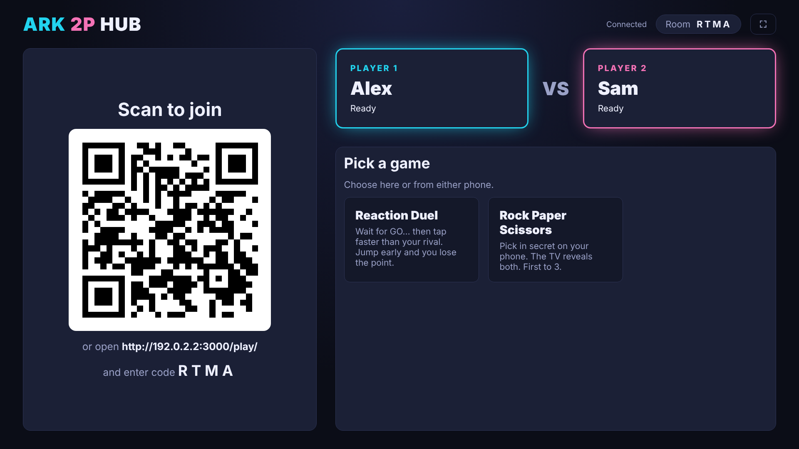
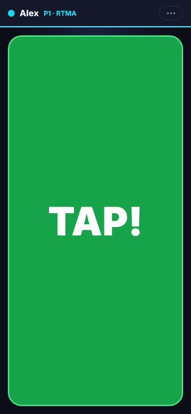
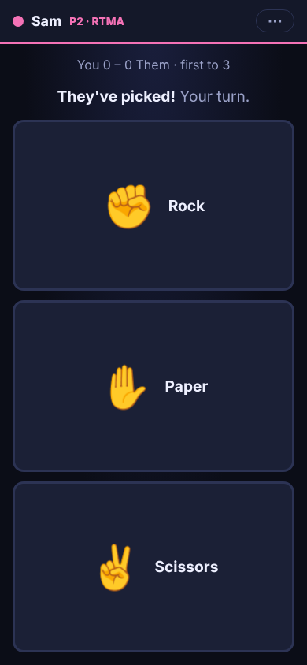

# Ark 2P Hub

Jackbox-style **1v1 party games** for your living room. The TV shows the game,
and each player's **phone is the controller**. Nothing to install: phones
scan a QR code and play in the browser. Self-hosted in a single Docker
container on your home network.

<p>
  
  
  
</p>

## Games

The lobby groups games into **⚔️ Competitive** (head to head, one of you wins),
**🎲 Dice & Board** (classic table games, head to head) and **🎨 Casual** (you play together, nobody really loses). Within each group
the games you played most recently come first (the last one is tagged
⏱ Last played), and **🎲 Random game** at the top picks one for you (never the
one you just played).

### ⚔️ Competitive

| Game | How it plays |
| --- | --- |
| **Reaction Duel** | The TV goes red… then GO! First tap wins. Tap early and your opponent gets the point. First to 3. |
| **Rock Paper Scissors** | Pick in secret on your phone; the TV reveals both. First to 3. |
| **Pong** | The classic, in real time. Drag on your phone's touch strip (or use the stick) to move your paddle. The ball speeds up every hit. First to 5. |
| **Light Cycles** | Tron-style. Your cycle leaves a wall behind it: make your rival crash into it. Tap a side of the phone pad or swipe to turn. Cycles speed up as the round goes on. First to 3. |
| **Snake Battle** | Two snakes, one arena. Eat the glowing food to grow; hit a wall, yourself or your rival and you lose the round. After 60 seconds the longer snake wins. Same controls as Light Cycles. First to 3. |
| **Tank Duel** | Top-down tank battle with cover. Drive with the joystick (or pick ✛ D-pad or 📱 Tilt on your phone), fire shells that bounce once off walls (trick shots, and watch out for your own). 3 hits and you're out; after 90 s the healthier tank wins. First to 3. |
| **Sumo** | Two discs on a round clay ring: steer with a joystick, ✛ D-pad or 📱 Tilt, picked on your phone (with momentum), and press **DASH** to ram (1.5 s cooldown; a dashing hit knocks harder). Leave the ring and you lose the round; after 15 s the ring starts shrinking, so every round ends. First to 3. |
| **Bomb Duel** | Bomberman-style, on a 15×11 arena of stone pillars and wooden crates. Walk with the D-pad on your phone (or a controller) and drop bombs with the big button: they go off after 2.5 s in a cross, smash the first crate each way and set off other bombs. Crates can hide power-ups: 💣 an extra bomb, 🔥 a longer blast, 👟 more speed. Caught in a blast, you lose the round (a trade is a draw); after 90 s the walls close in from the edges. Pick the round wins needed (2, 3 or 5) and how many crates before you start. |
| **Kart Race** | Top-down racing on the TV. Your kart accelerates on its own: steer from your phone and BRAKE for the tight bends. Each phone picks its own controller on the setup screen: 🔘 **Buttons** (hold ◀ ▶), 🕹️ **Joystick** (steer as far as you push; pull down to brake), 👆 **Slide** (put a finger down anywhere and slide) or 📱 **Tilt** (turn the phone like a wheel; tap to re-centre. Phones only let a web page use the motion sensor on a secure https page: on plain http the phone switches to the joystick and offers **🔒 Switch to the secure page**, see [Secure page (https)](#secure-page-https)). Pick a layout too: 🔄 Auto (follows how you hold the phone), ↔ Landscape (sideways even with rotation locked) or ↕ Portrait. Grass slows you right down, yellow boost pads shoot you forward, and you can bump your rival. Rainbow ? boxes give you an item to use with the ITEM button: a 🍌 banana to drop behind you (whoever hits it spins out), a ⚡ turbo, or a 🛡️ shield against bananas (the kart behind gets more turbos). Six tracks (Speedway, Kidney, Serpent, Grand Prix, Hairpins, Zigzag); no cutting across the grass: rejoin the road further on and you're put back where you left it. First across the line after the last lap wins. |
| **Quiz Battle** | 10 trivia questions from a bank of 250 (science, geography, history, movies, music, sports, games, food, nature and tech; play them mixed or pick one topic). Answers stay secret until the reveal; a right answer scores 500 plus up to 500 for speed. Most points wins, and rematches don't repeat questions. |
| **Draw Duel** | A shape flashes up for 4 seconds, then vanishes: redraw it from memory on your phone. 150 shapes (basic shapes, pictures like a rocket or a cat, letters and numbers), never repeated until you've seen them all. Each drawing is scored 0–100% for how closely it matches (size and position don't matter); the TV shows both drawings live and overlays the real shape at the reveal. 5 rounds, most points wins. |
| **Battleship** | Hide your 5 ships on your phone (tap a ship, tap where it goes, tap it again to turn it, or shuffle), then take turns firing at the enemy grid. The TV shows both oceans with every hit and miss; ships stay hidden until sunk. 30 s per shot. Sink the whole fleet to win. |
| **Word Race** | Boggle for two: the same letter grid on both phones and the TV. Swipe across touching letters (sideways, up/down or diagonally) to spell words of 3+ letters, checked against a ~275k-word dictionary; longer words score more (3–4 letters 1, 5 → 2, 6 → 3, 7 → 5, 8+ → 11). When the time's up, words you **both** found cancel out, so hunt for the rare ones. Before the match, either player picks the grid (4×4, 5×5 or 6×6), the time per round (1, 1½, 2 or 3 min) and the length (one round, best of 3 or best of 5); the hub remembers your choice, and at the end you can rematch or change them. |
| **Mini Golf** | Both of you play the same hole at once (the balls roll through each other). Pull back anywhere on your phone and let go to putt: the further you pull, the harder the shot; the phone shows the hole too. 15 holes with walls, bumpers, sand, water (a stroke penalty, back where you shot from), a moat and a windmill. 8 shots per hole, then you pick up and score 9; 90 s per hole. Pick 3, 6, 9, 12 or 15 holes before you start. Fewest strokes wins. |
| **Connect Four** | The classic: drop discs into a 7×6 grid and line up four (across, down or diagonally) before your rival. Tap a column on your phone, which shows the board too. 20 s per move (a random column if you run out); who starts swaps every round. First to 3 rounds. |
| **Memory Match** | A grid of face-down picture cards on the TV and your phone. Take turns flipping two: a pair is yours and you go again, otherwise they turn back over (remember them!) and it's your rival's go. Most pairs wins. |
| **Micro Mayhem** | WarioWare-style: tiny games of 3-4 seconds, both of you at once. A big order flashes up (TAP IT! STOP IT! SHAKE IT! ODD ONE OUT! COUNT 'EM! SWIPE IT! DON'T TOUCH! QUICK MATH!) and you have a moment to do it on your phone or controller. Miss one and you lose a ❤️; every 5 games the speed goes up. Last one with lives wins (both out at once: sudden death). |
| **Party Minigames** | Mario Party-style showdowns of 20-40 seconds: **Balloon Pump** (mash to pop yours first), **Hot Potato** (pass the bomb back before the secret fuse runs out), **Quick Draw** (fire on BANG!, too early loses), **Memory Path** (repeat the glowing path as it grows), **Sweet Spot** (stop your spinning number high, three times), **Coin Grab** (run around grabbing coins, dodge the 💣) and **Tug of War** (pull on the beat), plus three in **3D** on the TV: **Tower Stack** (drop the swinging block; the overhang is cut off), **Bowling Bash** (aim, power, two rolls) and **Penalty Shootout** (pick a corner or a dive, in secret). A *Next up* card explains each one; tap Ready. Win a minigame for a ⭐, first to 3 wins. |
| **Party Board** | Mario Party-style: take turns rolling (tap to stop the die) and hopping around one of five maps: 🏝️ Party Island and 🌊 Twin Lagoons (easy), 🔧 Pipe Works (medium), 👻 Haunted Maze (hard) and 🌋 Volcano Peak (expert: stars cost 30, the shop 50% more). Bigger maps have 🔀 forks (pick your path; the phone previews what's ahead) and 🌀 warp spaces that fling you to a random space (anywhere but the start or another warp). **💀 Harsh mode** scatters ⚡ thunder (lose half your coins), 💀 skulls (lose a star) and 🌪️ tornadoes (blown anywhere). 🔵 +3 🪙, 🔴 −3, ❓ events (coin shower, swap places, steal, lucky, the star moves), 🎰 a slot machine, 🛒 the shop (🍄 +3 roll, 🎲 double dice, 🌀 warp, 🦹 coin thief, 👻 star thief; hold 3). Pass the ⭐ with 20 🪙 (more on the harder maps) to buy it. A party minigame after every round pays +10 🪙. Bonus stars at the end for the most minigames won and the most coins earned; most ⭐ wins. 🏁 The end screen recaps the match (in 3D the winner spins on a pedestal under confetti): stars, coins, minigames won, coins earned, spent and lost, stars bought and stolen, warps and bonus stars. |

### 🎲 Dice & Board

| Game | How it plays |
| --- | --- |
| **Liar's Dice** | Your dice are hidden under a cup on your phone (the TV shows only how many each of you has). Take turns bidding how many of a face there are across *both* players' dice ("three 5s"): raise the count, or keep it and bid a higher face. Or call **Liar!**: the cups lift on the TV, and if there are fewer than bid, the bidder loses a die; otherwise the caller does. Ones are wild (they count as every face). Lose all your dice and you lose. Needs two phones. |
| **Dice Party** | Yahtzee-style: roll five dice up to three times, tapping the ones to hold between rolls, then score them in one of 13 boxes (ones to sixes, three and four of a kind, full house, small and large straight, five of a kind, chance). 63+ in the top boxes earns a 35 bonus. The TV shows the dice and both scorecards, with what each open box would score. Highest total wins. |

### 🎨 Casual

| Game | How it plays |
| --- | --- |
| **Sketch & Guess** | One of you picks a secret word (easy, medium or hard, from 400) and draws it on your phone with colours, undo and an eraser; the other watches it appear on the TV and their own phone and types guesses (near misses get a "so close!"). Letters are hinted as time runs out. Team up for stars: faster and harder words earn more. 6 rounds, taking turns to draw. |
| **Bomb Squad** | A co-op bomb-defusal game for two phones. One of you has the bomb on your phone, the other has the defusal manual on theirs, and neither may look at the other's screen. The defuser describes, the expert finds the rules and says what to do. Seven kinds of module: **wires** to cut, a **button** to tap or hold, **symbols** to press in order, **password** letter wheels, **Simon** (press the colours the manual's table gives for each flash; it changes with strikes), a **maze** with invisible walls (the green markers say which maze it is) and **switches** set by their lights. **Every bomb comes with a freshly dealt rulebook** (the edition code is on both phones), so there's no learning the manual by heart. Three strikes or the timer running out and it goes 💥. The TV shows the countdown, strikes and which modules are done. You swap roles every bomb and collect stars (more for time to spare). Easy, Normal, Hard or Expert (2 to 6 modules), 1, 3 or 5 bombs. |
| **Marble Maze** | Co-op in 3D: a marble on a wooden maze board that you tilt together. One of you tilts it left and right, the other forwards and back (or pick *Shared* and both steer everything). Roll it to the green goal without dropping it down a hole (down one, it's back to the start). Phones use the 🕹️ joystick, ✛ D-pad or 📱 tilt pad; controllers use the stick. Stars for each maze: three within par time. Five mazes, from *First roll* to *The gauntlet*. |
| **Mind Meld** | Co-op guessing on a scale, Wavelength-style. The TV shows a scale like *Cold ↔ Hot*; the clue-giver's phone shows a secret target on it, and they type a clue ("tea"). The other turns the dial (drag it on the phone, or the stick on a controller) and locks in: dead on is ⭐⭐⭐, close is ⭐⭐ or ⭐. 60 scales; you swap who gives the clue every round (a controller player always guesses). |
| **Air Hockey** | The whole table is on your phone too, upright and turned so your goal is at the bottom: slide your mallet and smash the puck into their goal. Watch the phone or the TV. First to 7. |

**Every game opens on a setup screen** where either player picks the match
settings on their phone (or a controller: ↑↓ picks a row, ←→ changes it, A
starts). The numbers above are the defaults; you can change, for example:

| Game | Setting |
| --- | --- |
| Reaction Duel, Rock Paper Scissors | Points to win: 3, 5 or 7 |
| Pong | Points to win: 3, 5, 7 or 11 |
| Air Hockey | Goals to win: 5, 7 or 10 |
| Light Cycles, Snake Battle, Tank Duel, Sumo, Bomb Duel | Round wins needed: 2, 3 or 5 |
| Connect Four | One round, or first to 3 or 5 |
| Quiz Battle | 5, 10, 15 or 20 questions, and the topic (mixed or one category) |
| Draw Duel | 3, 5, 7 or 10 rounds |
| Battleship | 15, 30 or 60 s per shot |
| Sketch & Guess | 4, 6, 8 or 10 rounds |
| Bomb Squad | Easy (2 modules), Normal (3), Hard (4) or Expert (6), and 1, 3 or 5 bombs |
| Marble Maze | 1, 3 or all 5 mazes; split (one ↔, one ↕) or shared controls |
| Mind Meld | 4, 6, 8 or 10 rounds |
| Liar's Dice | 5, 3 or 4 dice each; ones wild or not |
| Dice Party | Full game (13 rounds) or quick (6) |
| Micro Mayhem | 3 or 5 lives; normal pace or fast (starts at speed 3) |
| Party Minigames | First to 3, 4 or 5 wins; minigames: a mix, 2D only or 3D only |
| Party Board | Map (random or one of five), tile art ⚙️ steampunk with 3D models (default: steampunk tiles, a brass die with the roll on a number plate, a spinning collectible star, coins that pop up when won and scatter when lost), ⚙️ steampunk light (the faces on plain discs, for slower TVs) or 🎨 classic colours, board view 2D or 🧊 3D (every map has its own scenery: a palm island, sandy lagoons, a metal pipe yard, a foggy graveyard with ghosts, a lava field under a smoking peak; each player picks the steampunk engineer or mechanic miniature, which hop the paths, your character flies across the board when a warp flings it, a tumbling die, a camera that follows the turn), 10, 15 or 20 turns; minigames: a mix, 2D only or 3D only; bonus stars on or off; Harsh mode on or off |
| Word Race | Grid size, time per round and match length |
| Mini Golf | 3, 6, 9, 12 or 15 holes |
| Bomb Duel | Also how many crates |
| Kart Race | Track (or a mix), 3, 5 or 8 laps, one race or best of 3, items on or off |
| Memory Match | 16, 24 or 36 cards, the pictures (animals, food, sports, things, faces, nature, space & travel, ocean, or a mix), 10, 20 or 30 s per turn |

The room remembers your choice for next time. At the end of a match,
**Rematch** plays again with the same settings and **⚙ Change settings** (or
**Y** on a controller) goes back to the setup screen.

## Controllers

Each player can use a phone **or** a game controller. Mix and match: two
controllers, two phones, or one of each. Connect Xbox, PlayStation or most
other controllers (Bluetooth or USB) to the device showing the TV screen: the
PC on HDMI, the Raspberry Pi, or the Google TV box. Then:

| Where | Button | Does |
| --- | --- | --- |
| Lobby | **A** / **Start** | Join (takes a free seat as "Controller 1/2") |
| Lobby | **D-pad**, then **A** | Pick a game and start it (the first card, 🎲 Random, lets the hub choose) |
| Lobby | **Y** | Change your name: cycles through names on the leaderboard, so your wins count for you |
| Lobby | **X** | Tournament: off, best of 3, 5 or 7 games |
| Mind Meld | **Left stick** or **D-pad ← →** turns the dial, **A** locks in | Controller players always guess; the clue-giver needs a phone to type |
| Marble Maze | **Left stick** or **D-pad** tilts the board | In split mode only your axis counts: player 1 left/right, player 2 forwards/back. **A** plays again at the end |
| Dice Party | **X** rolls · **← →** picks a die, **A** holds it · **↑ ↓** picks a box, **Y** scores it | The TV highlights your die and box; Liar's Dice needs phones (the dice are secret) |
| Lobby | **B** | Leave your seat |
| Lobby | **Back** | Free the seats of phones that have left (shown as *Reconnecting…*) |
| Any game | **Back / Select** | Back to the lobby |
| Reaction Duel | any face button, bumper or trigger | Tap |
| Rock Paper Scissors | **X** ✊ · **Y** ✋ · **B** ✌️ (or D-pad ← ↑ →) | Pick (stays secret, the TV only shows 🔒) |
| Pong | **Left stick** or **D-pad ↑↓** | Move your paddle |
| Light Cycles | **D-pad** / **left stick** (or **Y**↑ **A**↓ **X**← **B**→) | Turn |
| Air Hockey | **Left stick** or **D-pad** | Move your mallet (in TV directions) |
| Snake Battle | **D-pad** / **left stick** (or **Y**↑ **A**↓ **X**← **B**→) | Turn |
| Tank Duel | **Left stick** or **D-pad** to drive, **A** / **RT** / **RB** / **X** to fire | Point where you want to go; the gun faces where you drive |
| Sumo | **Left stick** or **D-pad** to move, **A** / **B** / **RT** to dash | The dash goes where you're steering (or straight at your rival if you're not) |
| Bomb Duel | **D-pad** or **left stick** to walk (held), **A** / **B** / **X** / **RT** to drop a bomb | Setup: **↑↓** picks a row, **←→** changes it, **A** starts; at the end **A** rematches and **Y** changes the settings |
| Kart Race | **Left stick** or **D-pad ← →** to steer, **B** / **LT** / **↓** to brake, **A** / **X** / **RT** to use your item | The kart accelerates by itself. Setup: **↑↓** picks a row, **←→** changes it, **A** starts; at the end **A** rematches and **Y** changes the settings |
| Quiz Battle | **A** / **B** / **X** / **Y** to answer, or the **D-pad** as a diamond (↓ A, → B, ← X, ↑ Y) | Answer tiles on the TV are coloured like the buttons |
| Draw Duel | **Left stick** or **D-pad** moves a cursor, hold **A** / **RT** / **RB** to draw, **B** undo, **X** clear, **Y** / **START** done | Phones draw with a finger, which is easier; the controller is for brave players |
| Battleship | **D-pad** aims at the enemy grid on the TV, **A** fires | A controller player's fleet is placed at random, since the TV can't keep it secret |
| Word Race | Setup: **↑↓** picks a row, **←→** changes it, **A** starts. In the game: **D-pad** / **stick** moves a cursor, **A** adds the letter, **B** removes the last one, **Y** / **X** / **RT** submits the word. At the end, **A** rematches and **Y** changes the settings | Phones are easier (just swipe), and your trace shows on the TV for your rival to see |
| Mini Golf | **Left stick** aims (or **←→** turns the aim), hold **A** / **RT** to charge, let go to putt | The power meter swings up and down while you hold, so let go at the right moment. Setup: **←→** picks the holes, **A** starts; at the end **A** rematches and **Y** changes the holes |
| Connect Four | **D-pad** ← → (or the stick) moves your disc over the columns, **A** or **↓** drops it | |
| Party Board | **← →** pick an answer, **A** confirms (roll, buy, use an item, stop the slot) | Minigames play as below |
| Micro Mayhem, Party Minigames | Follow the order: **A** taps / stops / pumps / fires, **D-pad** picks and swipes, the **stick** steers the Tap it! cursor and wiggles to shake | **A** is Ready on the *Next up* card and rematch at the end |
| Memory Match | **D-pad** moves a cursor over the cards on the TV, **A** flips one (on your turn) | |
| Sketch & Guess | **A** / **B** / **X** / **Y** picks one of four words shown on the TV | Controller players always guess (the word has to stay secret from the guesser); wrong picks pause you for a moment |
| Game over | **A** / **Start** | Rematch |

Buttons use Xbox names. On a PlayStation controller A = ✕, B = ○, X = □, Y = △.
Browsers only notice a controller after one of its buttons is pressed, so
press A once if the TV says no controller is connected. Controllers rumble on
input where the browser supports it.

## Sound

The TV plays sound effects for every game: countdown beeps, GO, points,
bounces, crashes, explosions, splashes, right and wrong answers, and a fanfare
at the end. They're generated in the browser (no audio files). Browsers only
allow sound after someone interacts with the page, so the first time the TV
shows **🔈 Tap for sound** in the top bar: click it, or press OK on a TV remote
or any key. The 🔊 button mutes and unmutes (remembered on that TV). The
Raspberry Pi kiosk is allowed to play sound straight away.

There's background music too, composed live in the browser as it plays: a
laid-back tune in the lobby (and on game setup and results screens), and in
games one of three moods: **action** chiptune for the real-time games,
**thinking** for the quiz, word and board games, and **casual** for the
relaxed ones. Each mood keeps its chords, bass and beat, but the melody is
made up fresh every 8 bars, so it doesn't loop the same tune. The 🎵 button
turns music on and off separately from the sound effects (remembered on that
TV). A new game picks its mood with `music: 'action' | 'thinking' |
'casual'` (by default competitive games get action, casual games casual).

## Tournament

Play a series across games: in the lobby (TV or either phone) pick
**Best of 3**, **5** or **7**, or **Off** (the default). Every competitive match
you finish counts (rematches too). A draw scores nothing, and casual games
don't count. The first to win most of the games, e.g. 3 of 5, takes the
tournament. The score sits in the TV's top bar during games and on the phones
at the end of each match. **↺ Start over** clears it. After a win, the next
game starts a new series. A new player taking a seat also starts a new series.
On a controller, **X** in the lobby cycles the length.
Won tournaments are saved: the leaderboard (`/stats/`) counts each player's
🏆 titles and lists recent tournaments. The lobby shows the two players'
tournament record next to their head to head.

## Secure page (https)

The hub answers both `http://` and `https://` on the same port (3000).
Phones need the https page for the motion sensor (📱 Tilt in Kart Race, Tank
Duel and Sumo). When a phone picks Tilt on the http page, it offers
**🔒 Switch to the secure page**: the same room and the same seat, over https.
The hub signs its own certificate (made once and kept in the data folder), so
each phone warns the first time. Choose **Advanced → Proceed** (Android) or
**Show details → visit this website** (iPhone). To make every phone start on
https, set the join address in Settings (`/admin/`) to
`https://<your-server>:3000`. Set `HTTPS=off` to serve plain http only.

## Leaderboard and match history

Every finished match (and every tournament won) is saved (in `stats.json` in the data folder, so it
survives updates). The lobby on the TV and phones shows the record between the
two players seated, e.g. **🏆 Abe 14 – 9 Sam · last: Pong, Abe won 5–3**, plus
stars earned together in casual games. The 🏆 button on the TV (and the link in
the phone lobby) opens `/stats/`: players ranked by wins, rivalries, the best
player per game, and recent matches. Players are matched by name (ignoring
capitals), so use the same name each time. Settings (`/admin/`) can clear the
history.

## Quick start

### Docker (any machine on your network)

```bash
docker compose up -d --build
```

Then open `http://<server-ip>:3000/host/` in the TV's browser (a PC on HDMI,
a Google TV browser, or a Raspberry Pi; see below). Phones scan the QR code.

#### Fixing the QR code address

Inside Docker, the server only knows its own internal IP. If the TV page is
opened as `http://localhost:…` (for example on the server itself), the QR code
can point somewhere phones can't reach, and the TV shows a ⚠ warning. To fix it:

1. On a phone or PC, open `http://<server-ip>:3000/admin/` (or press ⚙ on the TV screen).
2. The first visit asks you to create an admin password.
3. Press **Use this page's address**, or type the address, then **Save**. The QR
   code on the TV updates right away.

The setting is stored in the `ark-data` Docker volume, so it survives updates.
You can also set `ADMIN_PASSWORD` and/or `PUBLIC_URL` in `docker-compose.yml`;
`PUBLIC_URL` overrides the saved address.

### Update and redeploy from GitHub

Clone the repo once on the Docker machine, then run the update script from the
repo folder whenever you want the latest version:

```bash
git clone https://github.com/areyesromo/Ark-2P-Hub.git && cd Ark-2P-Hub

./update.sh                  # Linux / macOS / Pi
./update.sh --branch main    # switch to (and follow) another branch
./update.sh --force          # recreate the container even if nothing changed
```

```powershell
.\update.ps1                 # Windows (Docker Desktop), PowerShell 5.1 or 7
.\update.ps1 -Branch main
.\update.ps1 -Force
```

It runs `git pull`, builds the image, redeploys with Docker Compose, then
checks `http://localhost:3000/version` and prints the version and commit that
are running. Details:

- **Failed build:** the running container is left as it is.
- **Pinned version:** if you've checked out a tag or commit to roll back, it
  won't pull.
- **Local changes:** they're kept, and the build is tagged `+dirty`.
- **Common git errors:** it explains them, including folders owned by another
  user ("dubious ownership") and ZIP downloads that aren't a git clone.
- **Screens:** after an update the TV and phones reload by themselves, and the
  TV keeps its room code, so phones reconnect without scanning again. (A game in
  progress does end, so update between games.)

If Windows blocks the script, run `Set-ExecutionPolicy -Scope Process Bypass` first.

To update automatically, schedule it:

- **Linux (cron):** `*/10 * * * * /path/to/Ark-2P-Hub/update.sh >> /var/log/ark-update.log 2>&1`
- **Windows (Task Scheduler):** run `powershell.exe -NoProfile -ExecutionPolicy Bypass -File C:\path\to\Ark-2P-Hub\update.ps1` on a timer.

### Raspberry Pi 4/5 as a plug-in console

The Pi runs the server *and* shows the TV screen full-screen from boot, pairs
Bluetooth controllers and updates itself from GitHub (never mid-game; the TV
keeps its room code and phones reconnect by themselves). On Raspberry Pi OS
(64-bit, with desktop), as your normal user:

```bash
curl -fsSL https://raw.githubusercontent.com/areyesromo/Ark-2P-Hub/main/deploy/pi/install.sh | bash
sudo reboot
/opt/ark/pair-controller.sh   # once per Bluetooth controller
```

Full guide: [docs/raspberry-pi.md](docs/raspberry-pi.md). The installer also
adds a colour emoji font for the TV (Memory Match cards, power-up icons); on a
Pi set up before that, run `sudo apt install fonts-noto-color-emoji` once.

### Local development

```bash
npm install
npm run dev        # restarts on file changes
npm test
```

Open <http://localhost:3000/host/> in one window and
<http://localhost:3000/play/> in two others (or on your phone via your
computer's LAN IP).

## How it works

```
TV browser  /host  ◄──┐
                      ├── Socket.IO ──►  Node server (rooms + game logic)
Phone P1    /play  ◄──┤
Phone P2    /play  ◄──┘
```

- **The server is the source of truth.** Phones only send inputs
  (`{ type: 'tap' }`); the server runs the game and pushes a *view* to each
  screen. The TV gets the full picture, and each phone gets only what that player
  should see (e.g. Rock Paper Scissors picks stay secret).
- **Reconnects are built in.** Phones keep a seat token, so a locked screen,
  a refresh or a Wi-Fi blip drops you straight back into your seat. The TV
  resumes its room after a refresh too. A phone that lost its token (another
  browser, cleared storage) gets its seat back by joining under the same name
  while that seat shows *Reconnecting…*; while the player is still there, the
  name is taken.
- **Removing a player:** tap ✕ on their seat on the TV, then **Remove?** to
  confirm (their phone goes back to the join screen). With a controller,
  **Back** in the lobby frees the seats of phones that have left.
- **Room codes** are 4 letters; rooms are cleaned up after 30 idle minutes.

```
server/
  app.js, index.js        HTTP + Socket.IO setup
  sockets.js              the socket protocol (join, start game, input…)
  rooms.js                rooms, seats, running a game
  games/                  one file per game (pure logic, unit-tested)
public/
  host/                   TV page
  play/                   phone controller page
  games/<id>/host.js      how a game looks on the TV
  games/<id>/player.js    how a game looks/behaves on the phone
deploy/pi/                Raspberry Pi installer, compose, kiosk, updater, controller pairing
update.sh / update.ps1     pull from GitHub, rebuild and redeploy
```

## Adding a game

1. **Logic:** create `server/games/<id>.js` exporting
   `{ id, name, tagline, category, create(ctx) }` (`category` is
   `'competitive'`, the default, `'board'` or `'casual'`). The instance implements
   `start()`, `onInput(slot, input)`, `hostView()`, `playerView(slot)`.
   Use `ctx.setTimeout` (cleared automatically when the game ends) and call
   `ctx.update()` whenever state changes. `ctx.players[slot].local` is true
   for controller players, who have no private screen (see `battleship`).
   `ctx.saved` is an object the room keeps between launches of your game.
   For match settings picked on a setup screen, declare
   `OPTIONS = { key: [default, ...choices] }` and use
   `server/games/options.js` on the server and `Ark.setup` on the TV and
   phones (see `word-race` and `mini-golf`): the room remembers the choice.
   Simpler: register your game wrapped in `withSetup(game, spec)` (see
   `server/games/index.js`) and read the choice with
   `settingOf(ctx, key, default)`: the hub draws the setup screen for you.
   Register it in `server/games/index.js`.
2. **TV:** `public/games/<id>/host.js` calls
   `Ark.register('host', '<id>', { mount(el), update(view) })`.
   For controller players, also give it a `padHint` string and a
   `pad(button, view, slot)` function that turns a button name (`A`, `B`, `X`,
   `Y`, `LB`, `RB`, `LT`, `RT`, `START`, `UP`/`DOWN`/`LEFT`/`RIGHT`) into the same
   input a phone would send, or `null`. Real-time games can add
   `padPoll({ held, stick }, view, slot)`, called every frame, for analog
   input (see `pong`). An optional `sounds(prev, view)` returns sound effect
   names to play when the view changes (see `public/host/sound.js` for the list).
3. **Phone:** `public/games/<id>/player.js` calls
   `Ark.register('player', '<id>', { mount(el, api), update(view) })`
   and sends inputs with `api.send({...})`.
4. Add a test in `test/` using the `fakeCtx()` helper (manual clock, no waiting).

**Adding a minigame** to Micro Mayhem or Party Minigames is smaller: write
`server/games/minis/<id>.js` (`{ id, kind: 'micro' | 'party', name, order, howTo,
durationMs, create(api) }`, see `server/games/minis/runner.js`) and its renderer
`public/games/minis/<id>.js` (`ArkMini.register(id, { host, phone, pad })`, see
`public/games/minis/mini.js`), then list it in `server/games/minis/index.js`.

`pong` is the template for real-time games (server physics loop, canvas on the
TV, touch strip on the phone), `reaction-duel` for timing games and
`rock-paper-scissors` for turn-based / hidden-information games.

## Notes

- Reaction times are measured on the server, so they include Wi-Fi latency
  (usually a few ms on a LAN). It's the same for both players.
- Phone screen wake-lock and vibration work where the browser allows it;
  iOS needs HTTPS for wake-lock, which the hub's secure page provides (see
  [Secure page (https)](#secure-page-https)).
- Party Board art: the tile faces live in `public/games/party-board/tiles/` (256 px WebP, one per
  space type plus `star`), the 3D models in `public/games/party-board/models/`: `tile.glb` (one body
  for every space; the face is swapped per type), `die.glb`, `star.glb` and `coin.glb`. For a new
  tile model, export a `.glb` lying flat with its face up and a mesh named `face` (UV-mapped). Slim
  any model before adding it with `tools/slim_glb.py` (drop unseen parts with `--drop`, shrink
  textures with `--tex`; see the top of the script). Models load when the board starts; until then,
  or if one is missing, the plain shapes stay.
- Building 3D board environments (trees, buildings, backdrops) for each map: see the art brief,
  blueprints and renders in [`docs/party-board-art/`](docs/party-board-art/README.md).

## Roadmap ideas

**The plan: 2D on the Pi, 3D on Steam**

The hub keeps running on a Raspberry Pi (Docker + the browser) with the **2D** Party Board: light,
no 3D engine needed. The **3D** board becomes the desktop experience, built for a Steam Deck as the
minimum and a gaming PC as typical, with the graphics turned all the way up:

1. **Desktop app**: Electron (Node + Chromium) wraps the hub: it starts the server inside the app
   and opens the TV screen full-screen; phones still join with the QR code. A Windows installer and
   a Linux AppImage (Steam Deck: add it to Steam as a non-Steam game; the Deck's controls are a
   gamepad, so the Deck can be P1). Big 3D assets ship inside the app, not in the Pi's Docker image.
2. **High graphics** in the app: real shadows, glow on emissive parts (lava, furnaces, pumpkins),
   fog and mist, full-resolution textures, the full-detail characters; plus each map's environment
   model (`env-<map>.glb`, with `space_NN` anchors, `path_` / `pedestal` nodes and animated parts;
   see [`docs/party-board-art/`](docs/party-board-art/README.md)).
3. **Steam**: Steamworks (achievements, overlay), Steam Deck verification (readable at 1280×800, full
   controller support), the store page. Optional later: online rooms (a relay so friends can join
   from anywhere, as Jackbox does) and Remote Play Together.

**Wishlist: 3D and more co-op**

The Pi 4's GPU handles WebGL, so these would use three.js like Marble Maze
(served by the hub at `/vendor/three/`, no internet needed), steered with the
joystick, D-pad or tilt pads:

- **3D Bowling**: swipe or tilt to roll; ten frames, highest score wins.
- **Tower Stack 3D** (co-op or versus): drop blocks to build the tallest tower before it topples.
- **Kitchen Rush** (co-op): an Overcooked-style kitchen; chop, cook and serve orders before they expire.
- **Trivia Quest** (co-op): beat a monster together with the quiz questions.
- **More minigames**.
- **HD 3D models and textures** for the 3D board and minigames (part of the desktop plan above): richer scenery and the full-detail characters, with shadows turned back on (`scene3d(el, { shadows: true })`).
- **Crazy Eights**: a secret hand of cards on your phone.

**More content**

- Even more quiz questions, shapes, words and holes: they're plain lists in
  `server/games/quiz-questions.js`, `shape-library.js`, `sketch-words.js` and
  `mini-golf.js` (COURSE), so adding your own is easy
