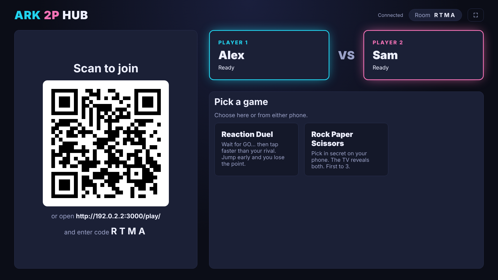
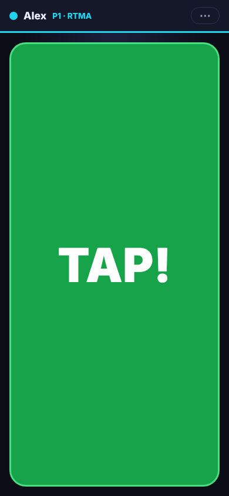
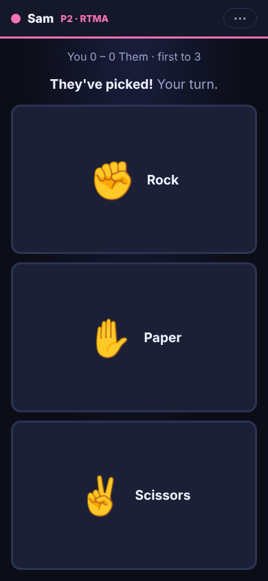

# Ark 2P Hub

Jackbox-style **1v1 party games** for your living room. The TV shows the game,
and each player's **phone is the controller**. Nothing to install: phones
scan a QR code and play in the browser. Self-hosted in a single Docker
container on your home network.

<p>
  
  
  
</p>

## Games

The lobby groups games into **⚔️ Competitive** (head to head, one of you wins),
**🎲 Dice & Board** (classic table games, head to head) and **🎨 Casual** (you play together, nobody really loses). Within each group
the games you played most recently come first (the last one is tagged
⏱ Last played), and **🎲 Random game** at the top picks one for you (never the
one you just played).
Once both seats are taken, the TV's lobby stacks the two players (with your
head to head and the tournament) in a narrow column on the left and gives the
rest of the screen to the games; the QR code comes back when a seat is free.
Two labels on a game tell you how it plays: **📱 No TV needed** (the phones show
everything, the board, the question, the reveal and the result, so nobody has to watch
the TV once you've joined: most board, card, word and quiz games, with the time left in the phone's header;
Dice Party with its Handheld screen) and **🤸 Motion** (you can tilt or move your phone to play; buttons
or a joystick always work too).
No one to play with? Games labelled **🤖 Vs computer** can be played against the computer:
Battleship (Classic and Ultimate), Connect Four, Checkers, Dots and Boxes, Mancala, Rock Paper
Scissors, Memory Match, Dice Party, Quiz Battle, Reaction Duel, Pong, Air Hockey, Snake Battle,
Light Cycles, Tank Duel, Word Hunt, Volley Blobs, Brick Breaker Duel, Rally Tennis, Sumo, Asteroid
Duel, Mini Golf, Falling Blocks Battle, Bomb Duel, Kart Race (and 3D, races and balloon battles),
Tower Defence Duel, Crazy Eights, Liar's Dice, Anagram Duel, Word Race, Party Board, Party
Minigames, Micro Mayhem (every minigame), and as your teammate in Trivia Quest, Kitchen Rush,
Dungeon Duo and Marble Maze. In Kart Race it readies up on the menus once you have. The phone-only games
need just your phone against it (it isn't a controller). With a seat free,
tap **Easy**, **Normal** or **Hard** under it on the TV (or on your phone's lobby, or press **LT**
on a controller). While it's seated, the games it can't play are greyed out (**🧑 Needs a
person**: the drawing and bluffing games). Easy makes mistakes and forgets, Normal plays sensibly, and
Hard looks further ahead (board games), remembers every card (Memory Match), reads your habits
(Rock Paper Scissors) and knows more answers. In the action games it answers what it sees no
faster than a person: it plays what it made of the moment a reaction time later, a slow player's
on Easy (about a third of a second), the average on Normal, a quick one's on Hard (about a fifth),
with a person's spread. What it sees coming (a tennis swing, a jump, its own planned turn) it
times, with a person's error. Its aim wobbles and it misjudges now and then, so it can always be
beaten. It plays from what its own phone would show, so it never
peeks at your fleet, your cards or your pick. Games (and tournaments)
against it don't count in the leaderboard; tap ✕ on its seat to send it away, or just join: whoever
scans in from the lobby takes its seat.

### ⚔️ Competitive

| Game | How it plays |
| --- | --- |
| **Reaction Duel** | The TV goes red… then GO! First tap wins. Tap early and your opponent gets the point. First to 3. |
| **Rock Paper Scissors** | Pick in secret on your phone; the TV reveals both. First to 3. |
| **Pong** | The classic, in real time. The whole court is on your phone too, turned so your paddle is at the bottom: drag left and right anywhere on it (or use the stick) to move your paddle. The ball speeds up every hit. First to 5. |
| **Volley Blobs** | Beach volleyball for two bouncy blobs. Hold ◀ ▶ on your phone (or the stick) to slide and tap JUMP; where the ball hits your dome sets where it goes, so jump into it to smash. Up to 3 touches a side, and the one who lost the point serves. First to 7. |
| **Brick Breaker Duel** | A race to break your own wall, side by side on the TV. Your wall, balls and paddle are on your phone too: drag left and right on it (or use the stick) to move your paddle; a missed ball just costs a moment. Power bricks shrink your rival's paddle, give you an extra ball or add a row to their wall. First to clear their wall wins; after 2 minutes, most bricks broken (level: next brick wins). |
| **Asteroid Duel** | Two ships in a field of drifting rocks, and the edges wrap round. Point the joystick (or the stick) where you want to face and push further to thrust; hold FIRE to shoot. Big rocks split when shot, and flying into one hurts. Three lives a round, a short shield after each hit; last ship flying takes the round. First to 3 rounds. |
| **Rally Tennis** | Tennis seen from above: your player runs to the ball by themselves, you time the swing. Tap SWING (or A) as the ball reaches you: spot on is a faster, deeper shot, a touch early pulls it left and late pushes it right, and holding ◀ ▶ aims too. Aim wide with a mistimed swing and it lands out. One swing per ball: too early or too late and it's gone. Tennis scoring (15, 30, 40, deuce); first to 4 games. |
| **Falling Blocks Battle** | A well each, side by side, and the same pieces in the same order for both. Slide ◀ ▶ (hold to keep going), rotate, hold ▼ to speed it down or DROP it at once. Clear 2 or more lines together and junk rows rise into your rival's well (2 lines send 1, 3 send 2, 4 send 4); your clears cancel junk coming at you first. Fill your well and you lose the round. First to 2 rounds. |
| **Light Cycles** | Tron-style. Your cycle leaves a wall behind it: make your rival crash into it. Tap a side of the phone pad or swipe to turn; the arena is on your phone too, above the pad. Cycles speed up as the round goes on. First to 3. |
| **Snake Battle** | Two snakes, one arena. Eat the glowing food to grow; hit a wall, yourself or your rival and you lose the round. After 60 seconds the longer snake wins. Same controls as Light Cycles, with the arena on your phone too. First to 3. |
| **Tank Duel** | Top-down tank battle with cover. Drive with the joystick (or pick ✛ D-pad or 📱 Tilt on your phone), fire shells that bounce once off walls (trick shots, and watch out for your own). 3 hits and you're out; after 90 s the healthier tank wins. First to 3. |
| **Tower Defence Duel** | Your own side of the TV each: a winding road down to your 🏰 base (20 lives by default), and the free tiles beside it for towers. Creeps walk the road; each one that gets through costs a life (a brute two), and when your lives are gone you lose. **Build** towers to stop them: 🏹 **Arrow** (cheap and quick), 💣 **Cannon** (slow, hits a whole group), ❄️ **Frost** (slows them down); each upgrades twice, or sell it back for part of the cost. **Send** creeps down your rival's road with your gold: 🏃 Runner (fast), 🐗 Brute (tough) or 🐜 Swarm (five small ones); every one you send also raises your income. Kills pay a bounty, and every 30 s both roads get the same house wave, a little stronger each time, so the game always ends. On the phone, your half of the map with the creeps walking it (and a small map of your rival's road): tap a tile to build or a tower to upgrade or sell, and the send buttons along the bottom. Both roads are the same. |
| **Sumo** | Two discs on a round clay ring: steer with a joystick, ✛ D-pad or 📱 Tilt, picked on your phone (with momentum), and press **DASH** to ram (1.5 s cooldown; a dashing hit knocks harder). Leave the ring and you lose the round; after 15 s the ring starts shrinking, so every round ends. First to 3. |
| **Bomb Duel** | Bomberman-style, on a 15×11 arena of stone pillars and wooden crates. Walk with the D-pad on your phone (or a controller) and drop bombs with the big button: they go off after 2.5 s in a cross, smash the first crate each way and set off other bombs. Crates can hide power-ups: 💣 an extra bomb, 🔥 a longer blast, 👟 more speed. Caught in a blast, you lose the round (a trade is a draw); after 90 s the walls close in from the edges. Pick the round wins needed (2, 3 or 5) and how many crates before you start. |
| **Kart Race** | Top-down racing on the TV. First, each player picks a **racer** on their phone: 12 of them (6 types, each in a male and a female version), each with their own kart and Speed / Acceleration / Handling / Weight stats, and **tyres** (Standard, Slicks, Grippy, Rollers, Monster) that shift those stats; the stat bars show what you get. Hold **GAS** to drive and let go to coast; hold **BRAKE** to slow down, and keep holding it once stopped to **reverse** (handy for backing off a wall). Hold **DRIFT** through a bend to turn tighter: drift long enough (the sparks turn orange) and let go for a mini-boost. Each kart has a speedometer on the TV (and a speed bar on its phone) plus lap times. Tyre walls line every road (and run between stretches of road that pass close together): a glancing hit slides you along, a head-on hit bounces you back. Grab the 🟡 **coins** dotted round the road (one at a time, alternating sides, so you weave to collect a run): each one you hold (up to 15) makes you a little faster; spinning out on a banana drops 3 and a head-on crash drops 1. Pick the track on the setup screen (a preview map shows it). Steering on the phone: 🔘 **Buttons** (hold ◀ ▶), 🕹️ **Joystick** (steer as far as you push; push up for gas, pull down to brake), 👆 **Slide** (put a finger down anywhere and slide) or 📱 **Tilt** (turn the phone like a wheel; tap to re-centre. Phones only let a web page use the motion sensor on a secure https page: on plain http the phone switches to the joystick and offers **🔒 Switch to the secure page**, see [Secure page (https)](#secure-page-https)). Pick a layout too: 🔄 Auto (follows how you hold the phone), ↔ Landscape (sideways even with rotation locked) or ↕ Portrait. Grass slows you right down, yellow boost pads shoot you forward, and you can bump your rival. Rainbow ? boxes give you an item (the gold **2** box in the middle of each row gives two); you hold up to 3 and the ITEM button uses the oldest first: 🍌 banana (drop it behind you: whoever hits it spins out), ⚡ turbo, 🛡️ shield (blocks one hit), 🌟 gold turbo (5 s of boosts on every press), ⭐ star (faster, untouchable, ram your rival to spin them), 💰 coin bag (+5 coins), 🧲 magnet (pulls in coins and boxes, slipstream behind your rival), 🎈 hover (float over grass and bananas), 🌩️ thunder (your rival shrinks: slower and lighter), 🧊 freeze (your rival's tyres ice up), 🔄 swap (trade items with your rival), 🕸️ web (drop it: whoever hits it is slowed right down), 🛢️ oil slick (drop it: whoever crosses it can't steer or brake for a moment), 🥏 bouncer (fires straight ahead and bounces off the walls: it spins out anyone it hits, you too), 🎯 seeker (chases your rival round the road; a banana or web stops it) or 💣 bomb (lobbed ahead, goes off after 1.5 s and spins out anyone close). The leader mostly gets defensive items; the kart behind gets the catch-up ones. Six tracks (Speedway, Kidney, Serpent, Grand Prix, Hairpins, Zigzag). Both players press **Ready** (or **A**), then five red **start lights** come on one by one and go out together: press GAS before they go out and it's a **jump start** (stalled for 1 s). First across the line after the last lap wins. Play one race, a best of 3, or a 🏆 **cup**: four races on four different tracks with a leaderboard between them; the most wins takes the cup (2–2 goes to a sudden-death race). Or pick 🎈 **Battle** instead of Race: no laps, just the two of you in a wide arena round an island (**Donut**, **Peanut** or **Plaza**, or a different one each round), starting on opposite sides with three balloons each. Every time you spin out (a banana, a bouncer, a seeker, a bomb, a star's ram) you lose a balloon; a shield takes the hit instead. Lose your last balloon and the round is theirs; after 2 minutes, whoever has more balloons left wins it (level: a draw round, played again). The ? boxes are always on, and both of you get the same items (no coin bag, gold turbo, magnet, thunder, swap or hover). Rematches wait for both of you too. |
| **Kart Race 3D** | **Kart Race** in 3D: the TV splits in two, with a camera behind each kart (yours on your side), so you race down the road instead of watching from above. The same racers, tyres, tracks, items, cups and 🎈 battles, played on your phone or a controller exactly like Kart Race (see its row above). Best on a PC or Steam Deck; on a screen that can't draw 3D it says so, and Kart Race is the one to play. For now the karts are simple 3D stand-ins in each racer's colours: proper 3D racers come later. Its lap records are its own (marked **3D** on the stats page). |
| **Quiz Battle** | 10 trivia questions from a bank of 250 (science, geography, history, movies, music, sports, games, food, nature and tech; play them mixed or pick one topic). Answers stay secret until the reveal; a right answer scores 500 plus up to 500 for speed. Most points wins, and rematches don't repeat questions. |
| **Fake Out** | A bluffing quiz for two phones. Each round the TV shows a strange-but-true fact with a blank ("In 1386 a French court put a ___ on trial for murder"), and you each secretly type a **fake answer** that sounds true; stuck? Your phone has one ready-made fake of its own. Then the TV (and your phone) lists four answers, shuffled: the truth, both your fakes and one more from the bank, and you each pick the one you think is real (your own fake isn't on your phone). Find the truth for **1000**; fool your rival with your fake for **500**; the last round counts double. The reveal goes answer by answer: whose fake it was and who fell for it, the truth last. 69 facts, and rematches don't repeat them. Write the real answer by accident and you're told, but finding it won't score that round. Needs two phones (you write your fake in secret). |
| **Draw Duel** | A shape flashes up for 4 seconds, then vanishes: redraw it from memory on your phone. 150 shapes (basic shapes, pictures like a rocket or a cat, letters and numbers), never repeated until you've seen them all. Each drawing is scored 0–100% for how closely it matches (size and position don't matter); the TV shows both drawings live and overlays the real shape at the reveal, and your phone shows your rival's drawing then too. 5 rounds, most points wins. |
| **Battleship** | Hide your 5 ships on your phone (tap a ship, tap where it goes, tap it again to turn it, or shuffle), then take turns firing at the enemy grid. The TV shows both oceans with every hit and miss; ships stay hidden until sunk. 30 s per shot. Sink the whole fleet to win. **⚡ Ultimate** (pick it in setup): each of you picks a commander, and each brings their own fleet, some of it angled (L, T and Z shapes and a 2 × 2 block, turning four ways): ⚓ Admiral Vega (the all-rounder), 🦈 Captain Mako (submarines that sonar can't see), 🧊 Commodore Frost (a fortress, with a shield), 🛰️ Engineer Nova (the scout), 🔥 Raider Ash (big guns), 🌪️ Admiral Tempest (a cross and a U) and 🦑 Captain Kraken (a hidden cross-shaped Leviathan). Every ship carries a skill you pay for with ⚡ energy (1 a turn and 1 for every hit): ✈️ Air Strike (3 in a line), 💥 Barrage (a plus of 5), 📡 Sonar (how many ship cells in a 3 × 3), 🌊 Torpedo (down a row to the first ship), 🎯 Double Shot and 🛡️ Shield (a secret 2 × 2 that stops the next hit on each ship cell under it). Lose a ship and its skill goes with it. Your commander's ⭐ special charges as you land hits: Lock-on (a line of 5), Wolf Pack (three torpedoes), Deep Freeze (they miss a turn), Full Scan (see the ships in a 5 × 5), Broadside (a 3 × 3), Typhoon (every other cell of a 4 × 4) or Deep Strike (a whole column). Every move plays out on the TV: explosions along the line, a torpedo's wake, a sonar sweep, a ship going down. 🤖 You can play it against the computer, Classic or Ultimate. Six seas: Open Sea, the Archipelago (islands), the Reef (rocks, and shallows only small ships fit), the Frozen Strait (ice that stops torpedoes), the Fog Bank (what a shot into the fog did shows only on your next turn, and torpedoes lose their way in it) and the Volcano (lava; after 8 turns it erupts once and hits every ship cell next to it, and if that sinks both fleets it's a draw). |
| **Word Race** | Boggle for two: the same letter grid on both phones and the TV. Swipe across touching letters (sideways, up/down or diagonally) to spell words of 3+ letters, checked against a ~275k-word dictionary; longer words score more (3–4 letters 1, 5 → 2, 6 → 3, 7 → 5, 8+ → 11). When the time's up, words you **both** found cancel out, so hunt for the rare ones (your phone lists your words and theirs at the end of each round). Before the match, either player picks the grid (4×4, 5×5 or 6×6), the time per round (1, 1½, 2 or 3 min) and the length (one round, best of 3 or best of 5); the hub remembers your choice, and at the end you can rematch or change them. **Race** mode: the first to the target points (20, 35 or 50) takes the round, words you both found count for both, and the round's time is only a cap (then more points wins). 🤖 Against the computer: it finds everyday words first, and fewer as they run out (more on Hard, which knows more words). |
| **Anagram Duel** | Both phones get the same five mixed-up letters: tap them in order to make a word that uses all five, and it goes off by itself once the last letter's in (⌫ takes one back). The first real word wins the round, and any real word counts, not only the one they came from. A wrong word locks you out for a second and a half, so tapping at random doesn't pay. Nobody in 30 seconds: no point, and the TV shows the word. The TV shows the letters and how far along each of you is (how many letters, not which). First to 5 rounds (or 3, or 7). 🤖 Against the computer: it takes a person's time to see each word (some come quicker than others), about 15 s on Easy, 9 on Normal, 5 on Hard. |
| **Word Hunt** | One word search on the TV and both phones, with the list of words to find. Drag from a word's first letter to its last (or tap both): the first to mark a word gets it, in their colour, and it's crossed off for both. Find more than half the words and the grid is yours; after 3 minutes, whoever has more takes it. 8 × 8 hides 7 words across and down, 10 × 10 hides 9 with diagonals too, and 12 × 12 hides 11 any way, even backwards; the words nobody found are outlined at the end. Works with controllers too (a cursor each on the TV). First to 2 grids (or 1, or 3). **Race** mode (two phones): the same grid, but your own copy each on your phone. You can both find every word, your finds stay on your phone (the TV and your rival only see how many you have), and the first to find them all takes the grid; when time's up, more words takes it. |
| **Mini Golf** | Both of you play the same hole at once (the balls roll through each other). Pull back anywhere on your phone and let go to putt: the further you pull, the harder the shot; the phone shows the hole too. 15 holes with walls, bumpers, sand, water (a stroke penalty, back where you shot from), a moat and a windmill. 8 shots per hole, then you pick up and score 9; 90 s per hole. Pick 3, 6, 9, 12 or 15 holes before you start. Fewest strokes wins. |
| **Bowling** | Ten-pin bowling in 3D: ten frames on one lane, taking turns a frame at a time, with the score card along the top of the TV. On your phone, drag the ball to where you stand, then swipe it up the lane: the swipe's angle aims, its speed is the power, and a curve in it puts spin on the ball, which hooks once it's off the oil near the pins. With motion (the https page) you can swing the phone instead. Real pin action: the pins knock each other over, so the pocket (just beside the head pin) strikes most and a straight hit on the head pin leaves splits. Strikes and spares score as in a real game, with bonus balls in the 10th frame; the higher total wins. Pick 10 frames or a quick 5, and bumpers for no gutter balls. 🤖 Vs the computer: it curves into the pocket and goes after what's left for the spare; Easy throws wide and now and then into the gutter, Hard rarely misses its line. |
| **Connect Four** | The classic: drop discs into a 7×6 grid and line up four (across, down or diagonally) before your rival. Tap a column on your phone, which shows the board too. 20 s per move (a random column if you run out); who starts swaps every round. First to 3 rounds. |
| **Memory Match** | A grid of face-down picture cards on the TV and your phone. Take turns flipping two: a pair is yours and you go again, otherwise they turn back over (remember them!) and it's your rival's go. Most pairs wins. **Race** mode (two phones): the same cards on each phone, and you both flip at once on your own board (a mismatch stays up until your next flip); the first to clear every pair wins, and the TV shows only how many pairs each of you has. |
| **Micro Mayhem** | WarioWare-style: tiny games of 3-4 seconds, both of you at once. A big order flashes up (TAP IT! STOP IT! SHAKE IT! ODD ONE OUT! COUNT 'EM! SWIPE IT! DON'T TOUCH! QUICK MATH!) and you have a moment to do it on your phone or controller. Miss one and you lose a ❤️; every 5 games the speed goes up. Last one with lives wins (both out at once: sudden death). 🤖 Against the computer: it reacts and times its taps like a person, and now and then slips (a tap on DON'T TOUCH!). |
| **Party Minigames** | Mario Party-style showdowns of 20-40 seconds: **Balloon Pump** (mash to pop yours first), **Hot Potato** (pass the bomb back before the secret fuse runs out), **Quick Draw** (fire on BANG!, too early loses), **Memory Path** (repeat the glowing path as it grows), **Sweet Spot** (stop your spinning number high, three times), **Coin Grab** (run around grabbing coins, dodge the 💣), **Tug of War** (pull on the beat), **Whack-a-Mole** (whack the moles in your colour, not theirs), **Fishing** (hook on the bite, reel without snapping the line), **Simon Says** (press the colour only when Simon says so), **Hurdle Dash** (a race over the same hurdles: jump each one just in time; clip one and you stumble), **Laser Dodge** (jump the low beams, duck under the high ones; three lives, the beams come faster) and **Pop the Most** (steer a crosshair and pop the balloons in your colour; gold is +3, spiky −2), **Safe Cracker** (turn the dial until it clicks, the phone buzzes and the lock light flickers, then TRY; three numbers open your safe), **Reflex Grid** (tap the lit squares before they fade; a dark one costs a point) and **Mirror Me** (remember the shape, then join the dots on your phone to draw it; three rounds, each a line longer; phones only, so nobody draws in plain sight on the TV), **Cannon Lob** (aim, hold FIRE to charge and lob it over the wall to knock your rival's tower down; watch the wind flag) **Stack Attack** (slide your tray to catch the falling crates; catch them off-centre and the stack leans until it topples), **Drum Beat** (tap the lane as each note hits the line: perfect, good or miss, with a bonus for a long streak) and **Musical Chairs** (circle the chair; when the music stops, sit first; sit while it's playing, or when it only dips, and you trip), plus nine in **3D** on the TV: **Tower Stack** (drop the swinging block; the overhang is cut off), **Bowling Bash** (swipe up the lane: the angle aims, the speed is your power; phones only), **Penalty Shootout** (pick a corner or a dive, in secret), **Glass Bridge** (left or right, row by row: one panel of each pair breaks), **Ice Rink Sumo** (slide on the ice and bump your rival off), **Bumper Cars** (ram your rival in the side or from behind for a point and spin them out; head-on doesn't count) **Paint Grab** (drive over the floor to paint it your colour, grab the paint buckets for a big splash; most tiles wins), **Archery** (aim, hold DRAW to steady the bow, let go to shoot; allow for the wind; three arrows each, or tilt the phone to aim) and **Curling** (swipe your stone down the ice, curve the swipe for curl, then tap SWEEP to carry it further; nearest the button wins). Two more you play by moving the phone: **Sword Duel** (when the arrow shows, slash your phone that way; too soon gives the point away) and **Pour It** (hold the phone up like a bottle and tip it sideways to pour, stand it up to stop: closest to the line without spilling). Fishing works with motion too (jerk to hook, wind the phone to reel), and Android phones buzz on a catch, a snap or a spill (iPhones can't vibrate from a web page, so a buzz only ever confirms what you did or a result, never warns you first; ⋯ → 📳 Test vibration checks a phone). Motion needs the secure (https) page; every motion game also has a button or swipe. A *Next up* card explains each one; tap Ready. Win a minigame for a ⭐, first to 3 wins. 🤖 Against the computer: it plays every minigame, with a person's reactions, timing and memory (Easy loses track of a long path), and only sees what your screen would. |
| **Party Board** | Mario Party-style: take turns rolling (tap to stop the die) and hopping around one of seven maps: 🏝️ Party Island and 🌊 Twin Lagoons (easy), 🔧 Pipe Works and 🌉 Sky Bridges (medium: a drawbridge across the middle is down for two rounds, then up for two, and while it's up you go the long way round), 👻 Haunted Maze and 🛒 Market Square (hard: two shops, and the shop prices, half to double, and the star price, 15 to 35, change every round) and 🌋 Volcano Peak (expert: stars cost 30, the shop 50% more). Bigger maps have 🔀 forks (pick your path; the phone previews what's ahead) and 🌀 warp spaces that fling you to a random space (anywhere but the start or another warp). **💀 Harsh mode** scatters ⚡ thunder (lose half your coins), 💀 skulls (lose a star) and 🌪️ tornadoes (blown anywhere). 🔵 +3 🪙, 🔴 −3, ❓ events (coin shower, swap places, steal, lucky, the star moves), 🎰 a slot machine, 🛒 the shop (🍄 +3 roll, 🎲 double dice, 🌀 warp, 🦹 coin thief, 👻 star thief; hold 3). Pass the ⭐ with 20 🪙 (more on the harder maps) to buy it. A party minigame after every round pays +10 🪙. Bonus stars at the end for the most minigames won and the most coins earned; most ⭐ wins. 🏁 The end screen recaps the match (in 3D the winner spins on a pedestal under confetti): stars, coins, minigames won, coins earned, spent and lost, stars bought and stolen, warps and bonus stars. 🤖 Against the computer: it heads for the star, saves for it, shops and uses its items, and plays the minigames. |

### 🎲 Dice & Board

| Game | How it plays |
| --- | --- |
| **Liar's Dice** | Your dice are hidden under a cup on your phone (the TV shows only how many each of you has). Take turns bidding how many of a face there are across *both* players' dice ("three 5s"): raise the count, or keep it and bid a higher face. Or call **Liar!**: the cups lift on the TV and both phones, and if there are fewer than bid, the bidder loses a die; otherwise the caller does. Ones are wild (they count as every face). Lose all your dice and you lose. Needs two phones (or one against the computer). Before the first match the TV plays a short example round (📖 How to play, a setting); during the game your phone explains each bid in plain words and shows the chance it's true. 🤖 Against the computer (one phone is enough): it only knows its own dice and plays the odds; Hard reads your bids and bluffs now and then. |
| **Dice Party** | Yahtzee-style: roll five dice up to three times, tapping the ones to hold between rolls, then score them in one of 13 boxes (ones to sixes, three and four of a kind, full house, small and large straight, five of a kind, chance). 63+ in the top boxes earns a 35 bonus. The TV shows the dice and both scorecards, with what each open box would score. Highest total wins. 📱 **No TV needed**: pick the **Handheld** screen and each phone shows the whole scorecard (yours and theirs, the bonus and the totals) with the dice and Roll in a tray at the bottom; tap a box in your column, then tap it again to score. |
| **Crazy Eights** | The card game, for two phones: your hand is secret on your phone (the cards you can play light up), the TV shows the pile, the suit to follow and how many cards each of you holds. On your turn play a card that matches the top card's **suit or rank**, or an **8** at any time and call the new suit. Can't (or won't) play? Draw one: play it if it fits, or pass. With **action cards** on, a **2** makes the other player draw two (unless they answer with a 2 of their own: they stack), a **Jack** gives you another turn and the **Queen of ♠** makes them draw five. 30 s a turn (out of time: you draw and pass). First to empty their hand wins the hand and scores what's left in the other's: 8s 50, picture cards 10, aces 1, the rest face value. When the draw pile runs out, the played cards are shuffled back in. If there's nothing left to draw and neither of you can play, the hand goes to whoever holds fewer points. 🤖 Against the computer (one phone is enough): it only knows its own hand; it keeps its 8s for when it needs them, and Hard saves its 2s for your last cards. |
| **Checkers** | Classic draughts on the TV. Men step diagonally forward; jump to capture, and jumps are a must (a piece that can keep jumping must). Reach the far row to crown a ♛ king that moves both ways. Take every piece or leave your rival with no move; 40 moves without a capture is a draw. Tap a piece on your phone (the board turns so yours are at the bottom), then a ◯. 30 s per move. |
| **Dots and Boxes** | Take turns joining two neighbouring dots. Close the fourth side of a box to claim it and go again, so don't hand your rival a chain of boxes. When every line is drawn, the most boxes wins. Tap a line on your phone. 20 s per move. |
| **Mancala** | Kalah with 6 bowls a side. Pick a bowl of yours and sow its stones one by one counter-clockwise into the next bowls and your store (never your rival's). End in your store and go again; end in an empty bowl of yours with stones opposite and capture them all. When one side runs out, the stones left on the other side go to their owner's store, and the fullest store wins. Tap a bowl on your phone (your side is always at the bottom). 30 s per move. |

### 🎨 Casual

| Game | How it plays |
| --- | --- |
| **Sketch & Guess** | One of you picks a secret word (easy, medium or hard, from 400) and draws it on your phone with colours, undo and an eraser; the other watches it appear on the TV and their own phone and types guesses (near misses get a "so close!"). Letters are hinted as time runs out. Team up for stars: faster and harder words earn more. 6 rounds, taking turns to draw. |
| **Bomb Squad** | A co-op bomb-defusal game for two phones. One of you has the bomb on your phone, the other has the defusal manual on theirs, and neither may look at the other's screen. The defuser describes, the expert finds the rules and says what to do. Seven kinds of module: **wires** to cut, a **button** to tap or hold, **symbols** to press in order, **password** letter wheels, **Simon** (press the colours the manual's table gives for each flash; it changes with strikes), a **maze** with invisible walls (the green markers say which maze it is) and **switches** set by their lights. **Every bomb comes with a freshly dealt rulebook** (the edition code is on both phones), so there's no learning the manual by heart. Three strikes or the timer running out and it goes 💥. The TV shows the countdown, strikes and which modules are done. You swap roles every bomb and collect stars (more for time to spare). Easy, Normal, Hard or Expert (2 to 6 modules), 1, 3 or 5 bombs. |
| **Marble Maze** | Co-op in 3D: a marble on a wooden maze board that you tilt together. One of you tilts it left and right, the other forwards and back (or pick *Shared* and both steer everything). Roll it to the green goal without dropping it down a hole (down one, it's back to the start). Phones use the 🕹️ joystick, ✛ D-pad or 📱 tilt pad; controllers use the stick. Stars for each maze: three within par time. Eight mazes, from *First roll* to *The gauntlet*, plus three with moving parts: *Sliding door* (an orange block slides along a groove: cross while it's away, or it squashes you), *Conveyor belts* (they push the marble the way their arrows point) and *Button and gate* (roll over the red button to open the red gate). 🤖 With the computer as your teammate: it tilts its half (or, in Shared, lends a hand), steering round the holes, waiting for the sliding block and heading for the button first; Easy lets the marble run a bit fast. |
| **Tower Stack** | Co-op stacking in 3D: build one tower together, a block at a time. Each new block slides back and forth over the top; tap **DROP** on your phone (or **A**) and whatever hangs over the edge is cut off and falls, so the tower (and every block after it) gets narrower. Drop it dead on and it snaps into place whole; three of those in a row and the blocks start growing back. You take turns: player 1 drops the blocks sliding left-right, player 2 the ones sliding front-back. Missing the tower costs one of your shared lives (3, or 5 on Easy) and you try that floor again. It speeds up as it grows. Stars for height (15, 35 and 60 floors; 10, 25 and 40 on Easy). 🤖 With the computer as your teammate: it times its drops as the block crosses the middle; Hard is nearly always dead on, Easy cuts it often. |
| **Trivia Quest** | Co-op quiz: the two of you against three monsters in a row, a 🦠 Goo Blob, a 🗿 Stone Golem and the 🐉 Dragon, each with a health bar, while you share a row of ❤️ hearts. Every turn is a question from the Quiz Battle bank (mixed or one topic); you both answer secretly on your phones (talk it over first: that's the point) and it's revealed when you've both answered (there's no timer unless you pick **Timed** in setup: then 15 s a question, 12 s against the Dragon, and the faster a right answer comes the harder it hits). A right answer hits the monster, and both right is a ⚡ **team strike** for half as much again; every wrong or missing answer costs a heart. Beat a monster for up to ⭐⭐⭐ (3 with no hearts lost against it, 2 with one, 1 otherwise), so a perfect quest is 9 ⭐; run out of hearts and the quest ends with the stars you have. Each of you has one 💡 **50/50** per quest: it takes two wrong answers off your own phone. Rematches don't repeat the last quest's questions. |
| **Kitchen Rush** | Co-op cooking, seen from above on the TV: two chefs (in your colours) serve the orders before they run out. Walk with your phone's pad (joystick, D-pad or tilt) or a controller's stick; **ACTION** picks up, puts down and serves whatever you're facing, and you hold **CHOP** at a chopping board. Tomatoes and lettuce need chopping, meat cooks on a stove (and **burns** if you leave it), buns are ready as they are: put them on a plate and hand it in at the hatch. Order tickets come in along the top (🍔 burger, 🍔🥬 lettuce burger, 🍔🥬🍅 the works, 🥗 salad, and in the Food Truck 🧀 cheeseburger and the deluxe with everything), each with its own timer: a dish served earns coins plus a tip for speed, an order that runs out costs some. Four kitchens: the open **Diner**, **Split** (buns, meat and stoves on one side, the vegetables, plates and hatch on the other: pass things over the counter), **Rush Hour** (split, with orders coming faster) and the **Food Truck** (a narrow kitchen with a cheese crate, and two serving hatches that take turns: only the open one takes dishes). Stars at the end of the shift by the coins earned, with targets set by how many orders the shift brings (shown on the TV). 🤖 With the computer as your teammate: it takes whatever job helps most (meat off before it burns, chopping, plating up, serving, fetching what the orders still need), counts what you're carrying so it doesn't double up, and in the Split kitchen passes things over the middle. |
| **Dungeon Duo** | Co-op dungeon crawl in 3D: a 🛡️ **Fighter** and a ✨ **Healer** fight their way down five floors together (or three, for a short quest). Walk with your phone's pad (joystick, D-pad or tilt) or a controller's stick. **ATTACK** swings the Fighter's sword at whatever is in front, or fires one of the Healer's bolts. **SPECIAL** is the Fighter's shield (hold it: hits from the front are blocked and enemies shoved back, but you walk slower) or the Healer's healing circle (a heart a second for anyone standing in it, then a wait before the next). Enemies hurt on touch: slimes, bats and skeletons that throw bones from a distance. At no hearts you're down, and your partner revives you by standing beside you; both down and it's back to the start of the floor, which costs a continue. **The Cellar**: find the key, open the door, take the stairs together. **The Crypt**: spikes that go up and down, a gate that only stays open while one of you stands on a plate, and skeletons. **The Ice Caves**: a frozen lake you slide on, and big slimes that split in two when you beat them. **The Armory**: arrow traps that fire across the hall on a beat (the shield stops them), and an iron door that opens once you're both standing on its two levers at the same time. **The Warden's Hall**: the Stone Warden. Get out of its red ring before it slams, step out of its lane when it charges (a wall, or a raised shield, stuns it for a moment), and watch out for the help it calls at half health. Beat it to win. Stars for finishing, few retries and a good time. 🤖 With the computer as your teammate (the Fighter or the Healer, whichever you aren't): it fights, heals you, comes to revive you, dodges the Warden, holds the plate for you at a gate, takes the other lever, steers against the slide on ice, fetches the key and waits for you on the stairs. |
| **Mind Meld** | Co-op guessing on a scale, Wavelength-style. The TV shows a scale like *Cold ↔ Hot*; the clue-giver's phone shows a secret target on it, and they type a clue ("tea"). The other turns the dial (drag it on the phone, or the stick on a controller) and locks in: dead on is ⭐⭐⭐, close is ⭐⭐ or ⭐. 60 scales; you swap who gives the clue every round (a controller player always guesses). |
| **Air Hockey** | The whole table is on your phone too, upright and turned so your goal is at the bottom: slide your mallet and smash the puck into their goal. Watch the phone or the TV. First to 7. |

**Every game opens on a setup screen** where either player picks the match
settings on their phone (or a controller: ↑↓ picks a row, ←→ changes it, A
starts). The numbers above are the defaults; you can change, for example:

| Game | Setting |
| --- | --- |
| Reaction Duel, Rock Paper Scissors | Points to win: 3, 5 or 7 |
| Pong | Points to win: 3, 5, 7 or 11 |
| Volley Blobs | Points to win: 5, 7 or 11 |
| Brick Breaker Duel | Wall: 3, 5 or 7 rows of bricks |
| Asteroid Duel | Round wins needed: 2, 3 or 5 |
| Rally Tennis | Games to win: 3, 4 or 6 |
| Falling Blocks Battle | Round wins needed: 1, 2 or 3 |
| Air Hockey | Goals to win: 5, 7 or 10 |
| Light Cycles, Snake Battle, Tank Duel, Sumo, Bomb Duel | Round wins needed: 2, 3 or 5 |
| Tower Defence Duel | 10, 20 or 30 lives |
| Connect Four | One round, or first to 3 or 5; timed (20 s a move) or no timer |
| Quiz Battle | 5, 10, 15 or 20 questions, and the topic (mixed or one category) |
| Fake Out | 4, 6 or 8 rounds; timed (60 s to write, 20 s to pick) or no timer |
| Draw Duel | 3, 5, 7 or 10 rounds; timed (20 s to draw) or no timer (draw until you both press Done) |
| Battleship | Classic or ⚡ Ultimate, the sea for Ultimate (Open Sea, Archipelago, Reef, Frozen Strait, Fog Bank, Volcano or any), and 15, 30 or 60 s per shot, or no timer (placing and firing wait for you) |
| Sketch & Guess | 4, 6, 8 or 10 rounds |
| Bomb Squad | Easy (2 modules), Normal (3), Hard (4) or Expert (6), and 1, 3 or 5 bombs |
| Marble Maze | 1, 3, 5 or all 8 mazes; split (one ↔, one ↕) or shared controls |
| Tower Stack | Normal (3 lives) or Easy (slower blocks, 5 lives, an easier perfect) |
| Trivia Quest | The topic (mixed or one category), Easy (7 hearts), Normal (5) or Hard (3), and no timer (the usual: a question waits for you both) or timed (15 s a question, 12 s for the Dragon, and faster hits harder) |
| Kitchen Rush | The kitchen (Diner, Split, Rush Hour or Food Truck) and a 2, 3 or 4 minute shift |
| Dungeon Duo | Who's the Fighter and who's the Healer; Normal (3 continues) or Easy (more hearts, 5 continues, a weaker Warden); the full quest (5 floors) or a short one (3) |
| Mind Meld | 4, 6, 8 or 10 rounds; no timer (the usual) or timed (90 s for the clue, 60 s to guess) |
| Liar's Dice | The how-to-play example round first, or skip it; 5, 3 or 4 dice each; ones wild or not |
| Dice Party | Full game (13 rounds) or quick (6); the screen: TV, or 📱 Handheld (the whole scorecard on your phone, no TV needed) |
| Crazy Eights | Action cards (2, Jack, Q♠) or classic rules; one hand, or first to 100 or 200 points; timed (30 s a turn) or no timer |
| Checkers | One game, or first to 2 or 3; timed (30 s a move) or no timer |
| Dots and Boxes | A 4 × 4, 3 × 3 or 5 × 5 grid; one game, or first to 2 or 3; timed (20 s a move) or no timer |
| Mancala | 4, 3 or 5 stones per bowl; one game, or first to 2 or 3; timed (30 s a move) or no timer |
| Micro Mayhem | 3 or 5 lives; normal pace or fast (starts at speed 3) |
| Party Minigames | First to 3, 4 or 5 wins; minigames: a random mix, random 2D, random 3D, or one minigame of your choice (to practise it) |
| Party Board | Map (random or one of seven), tile art ⚙️ steampunk with 3D models (default: steampunk tiles, a brass die with the roll on a number plate, a spinning collectible star, coins that pop up when won and scatter when lost), ⚙️ steampunk light (the faces on plain discs, for slower TVs) or 🎨 classic colours, board view 2D or 🧊 3D (every map has its own scenery: a palm island, sandy lagoons, a metal pipe yard, a foggy graveyard with ghosts, a lava field under a smoking peak, islands floating in the sky with a drawbridge, a market square with stalls; each player picks the steampunk engineer or mechanic miniature, which hop the paths, your character flies across the board when a warp flings it, a tumbling die, a camera that follows the turn), 10, 15 or 20 turns; minigames: a mix, 2D only or 3D only; bonus stars on or off; Harsh mode on or off |
| Word Race | Grid size, time per round, match length, and the mode: timed (shared words cancel) or Race to 20, 35 or 50 points |
| Anagram Duel | First to 3, 5 or 7 rounds |
| Word Hunt | Shared board or Race (your own board each), grid size (8 × 8, 10 × 10 or 12 × 12) and first to 1, 2 or 3 grids |
| Mini Golf | 3, 6, 9, 12 or 15 holes |
| Bowling | 10 frames or a quick 5; bumpers (no gutter balls) or none |
| Bomb Duel | Also how many crates |
| Kart Race | 🏁 Race or 🎈 Battle. Race: track (or a mix), 3, 5 or 8 laps, one race, best of 3 or a 🏆 cup (4 tracks, most wins), items on or off. Battle: arena (or a mix), one round, best of 3 or first to 3. Each player's racer and tyres |
| Kart Race 3D | As Kart Race |
| Memory Match | Take turns or Race, 16, 24 or 36 cards, the pictures (animals, food, sports, things, faces, nature, space & travel, ocean, or a mix), 10, 20 or 30 s per turn, or no timer |

The room remembers your choice for next time. At the end of a match,
**Rematch** plays again with the same settings and **⚙ Change settings** (or
**Y** on a controller) goes back to the setup screen.

## Controllers

Each player can use a phone **or** a game controller. Mix and match: two
controllers, two phones, or one of each. Connect Xbox, PlayStation or most
other controllers (Bluetooth or USB) to the device showing the TV screen: the
PC on HDMI, the Raspberry Pi, or the Google TV box. Then:

| Where | Button | Does |
| --- | --- | --- |
| Lobby | **A** / **Start** | Join (takes a free seat as "Controller 1/2") |
| Lobby | **D-pad**, then **A** | Pick a game and start it (the first card, 🎲 Random, lets the hub choose) |
| Lobby | **Y** | Change your name: cycles through names on the leaderboard (so your wins count for you), then ready-made ones (Ace, Blaze, Comet…) |
| Lobby | **X** | Tournament: off, best of 3, 5 or 7 games |
| Lobby | **LT** | Play the computer: it takes the free seat on Easy; press again for Normal, then Hard, then it leaves |
| Lobby | **LB** / **RB** | Pick your avatar and colour (D-pad to move, **A** to pick, **B** to close) |
| Mind Meld | **Left stick** or **D-pad ← →** turns the dial, **A** locks in | Controller players always guess; the clue-giver needs a phone to type |
| Marble Maze | **Left stick** or **D-pad** tilts the board | In split mode only your axis counts: player 1 left/right, player 2 forwards/back. **A** plays again at the end |
| Tower Stack | **A** (or **RT**) drops the block on your turn | Player 1 drops the blocks sliding left-right, player 2 the ones sliding front-back. **A** rematches at the end |
| Dice Party | **X** rolls · **← →** picks a die, **A** holds it · **↑ ↓** picks a box, **Y** scores it | The TV highlights your die and box; Liar's Dice needs phones (the dice are secret) |
| Checkers | **D-pad** moves the cursor · **A** picks a piece, **A** on a ◯ moves it · **B** drops it | |
| Dots and Boxes | **D-pad** moves to a dot · **A**, then a direction draws the line from that dot · **B** cancels | |
| Mancala | **D-pad ← →** picks one of your bowls (Player 2's are along the top) · **A** sows it | |
| Lobby | **B** | Leave your seat |
| Lobby | **Back** | Free the seats of phones that have left (shown as *Reconnecting…*) |
| Any game | **Back / Select** | Back to the lobby |
| Reaction Duel | any face button, bumper or trigger | Tap |
| Rock Paper Scissors | **X** ✊ · **Y** ✋ · **B** ✌️ (or D-pad ← ↑ →) | Pick (stays secret, the TV only shows 🔒) |
| Pong | **Left stick** or **D-pad ↑↓** | Move your paddle |
| Volley Blobs | **Left stick** or **D-pad ← →**, **A** | Slide, jump |
| Brick Breaker Duel | **Left stick** or **D-pad ← →** | Move your paddle |
| Asteroid Duel | **Left stick**, **D-pad** + **B**, hold **A** / **RT** | Steer (push the stick further to thrust; the D-pad turns, B thrusts), fire |
| Rally Tennis | **A** (or **B** / **RT**), **left stick** or **D-pad ← →** | Swing, aim |
| Falling Blocks Battle | **D-pad ← →** (or stick), **↓**, **↑**, **A** / **B** | Move (hold to repeat), soft drop, hard drop, rotate |
| Light Cycles | **D-pad** / **left stick** (or **Y**↑ **A**↓ **X**← **B**→) | Turn |
| Air Hockey | **Left stick** or **D-pad** | Move your mallet (in TV directions) |
| Snake Battle | **D-pad** / **left stick** (or **Y**↑ **A**↓ **X**← **B**→) | Turn |
| Tank Duel | **Left stick** or **D-pad** to drive, **A** / **RT** / **RB** / **X** to fire | Point where you want to go; the gun faces where you drive |
| Tower Defence Duel | **D-pad** moves your cursor on your side, **LB** / **RB** picks the tower, **A** builds or upgrades, **LT** sells; **X** / **Y** / **B** send a Runner / Brute / Swarm | The cursor shows the tower's range |
| Sumo | **Left stick** or **D-pad** to move, **A** / **B** / **RT** to dash | The dash goes where you're steering (or straight at your rival if you're not) |
| Bomb Duel | **D-pad** or **left stick** to walk (held), **A** / **B** / **X** / **RT** to drop a bomb | Setup: **↑↓** picks a row, **←→** changes it, **A** starts; at the end **A** rematches and **Y** changes the settings |
| Kart Race | **Left stick** or **D-pad ← →** to steer, **RT** / **A** gas, **LT** / **B** brake (hold to reverse), **X** / **RB** drift, **Y** / **LB** use your item | Let go of the gas to coast. On the setup screen the last two rows (**↓**) are your racer and tyres: **←→** to change. Setup: **↑↓** picks a row, **←→** changes it, **A** starts; at the end **A** rematches and **Y** changes the settings |
| Kart Race 3D | As Kart Race | |
| Quiz Battle | **A** / **B** / **X** / **Y** to answer, or the **D-pad** as a diamond (↓ A, → B, ← X, ↑ Y) | Answer tiles on the TV are coloured like the buttons |
| Trivia Quest | **A** / **B** / **X** / **Y** to answer, or the **D-pad** as a diamond (↓ A, → B, ← X, ↑ Y); **LB** / **RB** is your 💡 50/50 | Your 50/50's two answers are struck out on the TV in your colour |
| Kitchen Rush | **Left stick** or **D-pad** to walk, **A** picks up / puts down / serves, hold **X** (or **B**) to chop | The tile you're facing is outlined in your colour |
| Dungeon Duo | **Left stick** or **D-pad** to walk, **A** attacks, **B** is your special (hold it for the Fighter's shield, press it for the Healer's circle) | Your hearts are on the TV; the Warden's next move shows as a red ring or lane on the floor first |
| Battleship | **D-pad** aims at the enemy grid on the TV, **A** fires | A controller player's fleet is placed at random, since the TV can't keep it secret · Ultimate: **←→** and **A** pick a commander, **LB** / **RB** choose the shot, a skill or the special, **Y** turns a line (or the side a torpedo comes from). |
| Mini Golf | **Left stick** aims (or **←→** turns the aim), hold **A** / **RT** to charge, let go to putt | The power meter swings up and down while you hold, so let go at the right moment. Setup: **←→** picks the holes, **A** starts; at the end **A** rematches and **Y** changes the holes |
| Bowling | **Left stick** or **D-pad ←→** moves where you stand, **↑↓** turns your aim, hold **A** / **RT** for power, let go to bowl | The power meter swings up and down while you hold; push the stick sideways as you let go for spin. **A** rematches at the end |
| Connect Four | **D-pad** ← → (or the stick) moves your disc over the columns, **A** or **↓** drops it | |
| Party Board | **← →** pick an answer, **A** confirms (roll, buy, use an item, stop the slot) | Minigames play as below |
| Micro Mayhem, Party Minigames | Follow the order: **A** taps / stops / pumps / fires / whacks / reels, **A B X Y** are Simon's green / red / blue / yellow, **D-pad** picks and swipes (◀ ▶ on the Glass Bridge), the **stick** steers the Tap it! cursor, the Coin Grab runner and the Ice Rink Sumo puck, and wiggles to shake | **A** is Ready on the *Next up* card and rematch at the end |
| Memory Match | **D-pad** moves a cursor over the cards on the TV, **A** flips one (on your turn) | |
| Word Hunt | **D-pad** moves your cursor on the TV (in your colour), **A** on a word's first letter then **A** on its last, **B** lets go | |
| Game over | **A** / **Start** | Rematch |

Buttons use Xbox names. On a PlayStation controller A = ✕, B = ○, X = □, Y = △.
Browsers only notice a controller after one of its buttons is pressed, so
press A once if the TV says no controller is connected. Controllers rumble on
input where the browser supports it.

Word Race, Anagram Duel, Draw Duel, Liar's Dice, Bomb Squad, Sketch & Guess, Fake Out and Crazy
Eights need two phones, so they're greyed out in the lobby while a controller is seated.

## Profiles

Every player has an **avatar** (a fox, a robot, a rocket…) and a **colour**. The avatar shows on the
TV's player cards, in the phone's header and next to your name in the standings and rivalries; the
colour is the circle around it (the seats and games keep their Player 1 / Player 2 colours, so you
can always tell who's who). Pick them on your phone (tap your avatar at the top, or ⋯ → 🎨 Avatar
and colour), or on the TV: click a player's avatar, or press **LB** / **RB** on your controller.
Until you pick, your name gives you one of its own, the same every time. They're kept per name in
`profiles.json` in the data folder, so they survive updates.

## Sound

The TV plays sound effects for every game: countdown beeps, GO, points,
bounces, crashes, explosions, splashes, right and wrong answers, and a fanfare
at the end. They're generated in the browser (no audio files). Browsers only
allow sound after someone interacts with the page, so the first time the TV
shows **🔈 Tap for sound** in the top bar: click it, or press OK on a TV remote
or any key. The 🔊 button mutes and unmutes (remembered on that TV). The
Raspberry Pi kiosk is allowed to play sound straight away.

There's background music too, composed live in the browser as it plays: a
laid-back tune in the lobby (and on game setup and results screens), and in
games one of three moods: **action** chiptune for the real-time games,
**thinking** for the quiz, word and board games, and **casual** for the
relaxed ones. Each mood keeps its chords, bass and beat, but the melody is
made up fresh every 8 bars, so it doesn't loop the same tune. The 🎵 button
turns music on and off separately from the sound effects (remembered on that
TV). A new game picks its mood with `music: 'action' | 'thinking' |
'casual'` (by default competitive games get action, casual games casual).

### HD graphics

The 3D games (the 3D Party Board, Kart Race 3D, Dungeon Duo, Marble Maze, Bowling, Tower Stack and
the 3D minigames) draw in **HD** by default:
- **Glow:** what's meant to glow does (lava, lanterns, the goal ring, sparks, the players' rings).
- **Reflections:** soft studio reflections on the shiny things (balls, marbles, metal).
- **Shadows:** four times sharper.

The colours stay exactly as before. The **HD** button in the TV's top bar switches that TV to
**SD** (standard, the lighter look) for a slower screen, and back; it's remembered on that TV. HD
is made for a Steam Deck and up. The code is in `public/shared/hd3d.js`: a 3D renderer draws
through `ArkHD.create(...)`, and a material can opt in or out of the glow with `userData.glow`.

## Tournament

Play a series across games: in the lobby (TV or either phone) pick
**Best of 3**, **5** or **7**, or **Off** (the default). Every competitive match
you finish counts (rematches too). A draw scores nothing, and casual games
don't count. The first to win most of the games, e.g. 3 of 5, takes the
tournament. The score sits in the TV's top bar during games and on the phones
at the end of each match. **↺ Start over** clears it. After a win, the next
game starts a new series. A new player taking a seat also starts a new series.
On a controller, **X** in the lobby cycles the length.
Won tournaments are saved: the leaderboard (`/stats/`) counts each player's
🏆 titles and lists recent tournaments. The lobby shows the two players'
tournament record next to their head to head.

## Secure page (https)

The hub answers both `http://` and `https://` on the same port (3000).
Phones need the https page for the motion sensor (📱 Tilt in Kart Race, Tank
Duel and Sumo). When a phone picks Tilt on the http page, it offers
**🔒 Switch to the secure page**: the same room and the same seat, over https.
The hub signs its own certificate (made once and kept in the data folder), so
each phone warns the first time. Choose **Advanced → Proceed** (Android) or
**Show details → visit this website** (iPhone). To make every phone start on
https, set the join address in Settings (`/admin/`) to
`https://<your-server>:3000`. Set `HTTPS=off` to serve plain http only.

## Online play

Your friend isn't in the same room? Press **🌍 Invite someone online** under the seats on the TV.
The hub opens a temporary internet address (a free Cloudflare **quick tunnel**: no account, no
setup; `cloudflared` comes with the Docker image and the desktop app) and shows a second QR code
for their phone, plus a **remote screen** link (`/host/?watch=ROOM`) for a laptop or smart TV: it
mirrors your TV live, but they can't press anything on it. It's https, so tilt and motion work on
their phone too. **Stop** (or closing the room) takes the address down again.

While someone's online, the game cards say which games play well that way: **🌍 Great online**
for the ones that are all on the phone (📱 No TV needed), and **🐢 Best in the same room** for
fast action games, where a moment's internet delay shows.

Only the game pages go out over the internet: Settings (`/admin/`) and the leaderboard and
trophies (your household's names and results) stay at home, nobody outside can open a room on
your hub, and only the room that invited someone can be joined or watched, with
the invite's own key (it's in the QR code and links; a new one each invite), after so many wrong
tries from one address it waits a while. **Stop** (or turning online play off) sends whoever
came in over the internet away again. In Settings, **Online play** can turn the button off, stop
everything, or use **your own tunnel address** instead of a quick tunnel (if you already run a
Cloudflare tunnel, or any https address, to the hub: point it at port 3000 and paste its
address). Through a proxy of your own, keep the original Host (or send `X-Forwarded-Host`):
that's how the hub tells internet visitors from home.

## Leaderboard and match history

Every finished match (and every tournament won) is saved (in `stats.json` in the data folder, so it
survives updates). The lobby on the TV and phones shows the record between the
two players seated, e.g. **🏆 Abe 14 – 9 Sam · last: Pong, Abe won 5–3**, plus
stars earned together in casual games. The 🏆 button on the TV (and the link in
the phone lobby) opens `/stats/`: players ranked by wins, rivalries, the best
player per game, and recent matches. Players are matched by name (ignoring
capitals), so use the same name each time. Settings (`/admin/`) can clear the
history.

## Trophies and practice

**🏆 Trophies** are each player's own achievements (by name, like the leaderboard), 27 of them:
playing 10, 25 or every game; your first win, a clean sweep (they never score), 10 different games
won, 50 wins, 10 wins over the same rival, a best-of-7 tournament; feats like a Kart Race cup, a
Party Board win, Micro Mayhem without losing a life, beating the Stone Warden (and with every
star), three stars in Kitchen Rush's Rush Hour, a perfect nine-star Trivia Quest, every star in
Marble Maze, Bomb Squad (five bombs) or Mind Meld, a Turkey (three strikes in a row) and a perfect 300 in Bowling; and practice ones: beating the computer, on
Hard, on Hard in 10 games and in every game, and every star in a co-op game with it as your
teammate. A card slides in on the TV (and on your phone) when you earn one. The leaderboard
lists who has how many; tap a name (or **🏆 My trophies** in a phone's ⋯ menu) for the whole set,
with the ones still to earn greyed out and how to get them.

**🤖 Practice**: games against the computer stay out of the leaderboard and match history, but
your own record against it is kept (in `practice.json`): while it's seated, each game card shows
the levels you've beaten (**🤖 E✓ N✓ H·**), or your best stars with it as your teammate in the
co-op games. Settings (`/admin/`) can clear the trophies and practice records.

## Quick start

### Desktop app (Steam Deck, Linux, Windows)

One app runs the hub and opens the TV screen full screen: an **AppImage** for the Steam Deck and
Linux (add it to Steam as a non-Steam game to launch it from Game Mode) and an **installer** for
Windows. No Docker needed. Download them from the repository's **Releases** page. GitHub builds
them with **Actions → Desktop app → Run workflow**. The app updates itself: a new version shows an
**Update** banner in the lobby. Each release also has Steam library artwork. See
[desktop/README.md](desktop/README.md), and for the Deck the step-by-step
[Steam Deck guide](docs/STEAM-DECK.md).

### Docker (any machine on your network)

```bash
docker compose up -d --build
```

Then open `http://<server-ip>:3000/host/` in the TV's browser (a PC on HDMI,
a Google TV browser, or a Raspberry Pi; see below). Phones scan the QR code.

#### Fixing the QR code address

Inside Docker, the server only knows its own internal IP. If the TV page is
opened as `http://localhost:…` (for example on the server itself), the QR code
can point somewhere phones can't reach, and the TV shows a ⚠ warning. To fix it:

1. On a phone or PC, open `http://<server-ip>:3000/admin/` (or press ⚙ on the TV screen).
2. The first visit asks you to create an admin password.
3. Press **Use this page's address**, or type the address, then **Save**. The QR
   code on the TV updates right away.

The setting is stored in the `ark-data` Docker volume, so it survives updates.
You can also set `ADMIN_PASSWORD` and/or `PUBLIC_URL` in `docker-compose.yml`;
`PUBLIC_URL` overrides the saved address.

### Update and redeploy from GitHub

Clone the repo once on the Docker machine, then run the update script from the
repo folder whenever you want the latest version:

```bash
git clone https://github.com/areyesromo/Ark-2P-Hub.git && cd Ark-2P-Hub

./update.sh                  # Linux / macOS / Pi
./update.sh --branch main    # switch to (and follow) another branch
./update.sh --force          # recreate the container even if nothing changed
```

```powershell
.\update.ps1                 # Windows (Docker Desktop), PowerShell 5.1 or 7
.\update.ps1 -Branch main
.\update.ps1 -Force
```

It runs `git pull`, builds the image, redeploys with Docker Compose, then
checks `http://localhost:3000/version` and prints the version and commit that
are running. Details:

- **Failed build:** the running container is left as it is.
- **Pinned version:** if you've checked out a tag or commit to roll back, it
  won't pull.
- **Local changes:** they're kept, and the build is tagged `+dirty`.
- **Common git errors:** it explains them, including folders owned by another
  user ("dubious ownership") and ZIP downloads that aren't a git clone.
- **Screens:** after an update the TV and phones reload by themselves, and the
  TV keeps its room code, so phones reconnect without scanning again. (A game in
  progress does end, so update between games.)

If Windows blocks the script, run `Set-ExecutionPolicy -Scope Process Bypass` first.

To update automatically, schedule it:

- **Linux (cron):** `*/10 * * * * /path/to/Ark-2P-Hub/update.sh >> /var/log/ark-update.log 2>&1`
- **Windows (Task Scheduler):** run `powershell.exe -NoProfile -ExecutionPolicy Bypass -File C:\path\to\Ark-2P-Hub\update.ps1` on a timer.

### Raspberry Pi 4/5 as a plug-in console

The Pi runs the server *and* shows the TV screen full-screen from boot, pairs
Bluetooth controllers and updates itself from GitHub (never mid-game; the TV
keeps its room code and phones reconnect by themselves). On Raspberry Pi OS
(64-bit, with desktop), as your normal user:

```bash
curl -fsSL https://raw.githubusercontent.com/areyesromo/Ark-2P-Hub/main/deploy/pi/install.sh | bash
sudo reboot
/opt/ark/pair-controller.sh   # once per Bluetooth controller
```

Full guide: [docs/raspberry-pi.md](docs/raspberry-pi.md). The installer also
adds a colour emoji font for the TV (Memory Match cards, power-up icons); on a
Pi set up before that, run `sudo apt install fonts-noto-color-emoji` once.

### Local development

```bash
npm install
npm run dev        # restarts on file changes
npm test
```

Open <http://localhost:3000/host/> in one window and
<http://localhost:3000/play/> in two others (or on your phone via your
computer's LAN IP).

## How it works

```
TV browser  /host  ◄──┐
                      ├── Socket.IO ──►  Node server (rooms + game logic)
Phone P1    /play  ◄──┤
Phone P2    /play  ◄──┘
```

- **The server is the source of truth.** Phones only send inputs
  (`{ type: 'tap' }`); the server runs the game and pushes a *view* to each
  screen. The TV gets the full picture, and each phone gets only what that player
  should see (e.g. Rock Paper Scissors picks stay secret).
- **Reconnects are built in.** Phones keep a seat token, so a locked screen,
  a refresh or a Wi-Fi blip drops you straight back into your seat. The TV
  resumes its room after a refresh too. A phone that lost its token (another
  browser, cleared storage) gets its seat back by joining under the same name
  while that seat shows *Reconnecting…*; while the player is still there, the
  name is taken.
- **Removing a player:** tap ✕ on their seat on the TV, then **Remove?** to
  confirm (their phone goes back to the join screen). With a controller,
  **Back** in the lobby frees the seats of phones that have left.
- **Room codes** are 4 letters; rooms are cleaned up after 30 idle minutes.

```
server/
  app.js, index.js        HTTP + Socket.IO setup
  sockets.js              the socket protocol (join, start game, input…)
  rooms.js                rooms, seats, running a game
  games/                  one file per game (pure logic, unit-tested)
public/
  host/                   TV page
  play/                   phone controller page
  games/<id>/host.js      how a game looks on the TV
  games/<id>/player.js    how a game looks/behaves on the phone
deploy/pi/                Raspberry Pi installer, compose, kiosk, updater, controller pairing
update.sh / update.ps1     pull from GitHub, rebuild and redeploy
```

## Adding a game

First check [`docs/GAMES.md`](docs/GAMES.md): every game and minigame we have (what it is and its
files) and the ideas not built yet, so a new one doesn't repeat an old one. After adding one, run
`node tools/games-catalog.mjs` to update it (a test fails until you do).

1. **Logic:** create `server/games/<id>.js` exporting
   `{ id, name, tagline, category, create(ctx) }` (`category` is
   `'competitive'`, the default, `'board'` or `'casual'`). The instance implements
   `start()`, `onInput(slot, input)`, `hostView()`, `playerView(slot)`.
   Use `ctx.setTimeout` (cleared automatically when the game ends) and call
   `ctx.update()` whenever state changes. `ctx.players[slot].local` is true
   for controller players, who have no private screen (see `battleship`).
   `ctx.saved` is an object the room keeps between launches of your game.
   For match settings picked on a setup screen, declare
   `OPTIONS = { key: [default, ...choices] }` and use
   `server/games/options.js` on the server and `Ark.setup` on the TV and
   phones (see `word-race` and `mini-golf`): the room remembers the choice.
   Simpler: register your game wrapped in `withSetup(game, spec)` (see
   `server/games/index.js`) and read the choice with
   `settingOf(ctx, key, default)`: the hub draws the setup screen for you.
   Register it in `server/games/index.js`.
2. **TV:** `public/games/<id>/host.js` calls
   `Ark.register('host', '<id>', { mount(el), update(view) })`.
   For controller players, also give it a `padHint` string and a
   `pad(button, view, slot)` function that turns a button name (`A`, `B`, `X`,
   `Y`, `LB`, `RB`, `LT`, `RT`, `START`, `UP`/`DOWN`/`LEFT`/`RIGHT`) into the same
   input a phone would send, or `null`. Real-time games can add
   `padPoll({ held, stick }, view, slot)`, called every frame, for analog
   input (see `pong`). An optional `sounds(prev, view)` returns sound effect
   names to play when the view changes (see `public/host/sound.js` for the list).
3. **Phone:** `public/games/<id>/player.js` calls
   `Ark.register('player', '<id>', { mount(el, api), update(view) })`
   and sends inputs with `api.send({...})`.
4. Add a test in `test/` using the `fakeCtx()` helper (manual clock, no waiting).

**Adding a minigame** to Micro Mayhem or Party Minigames is smaller: write
`server/games/minis/<id>.js` (`{ id, kind: 'micro' | 'party', name, order, howTo,
durationMs, create(api) }`, see `server/games/minis/runner.js`) and its renderer
`public/games/minis/<id>.js` (`ArkMini.register(id, { host, phone, pad })`, see
`public/games/minis/mini.js`), then list it in `server/games/minis/index.js`.

`pong` is the template for real-time games (server physics loop, canvas on the
TV, touch strip on the phone), `reaction-duel` for timing games and
`rock-paper-scissors` for turn-based / hidden-information games.

## Notes

- Reaction times are measured on the server, so they include Wi-Fi latency
  (usually a few ms on a LAN). It's the same for both players.
- Phone screen wake-lock and vibration work where the browser allows it;
  iOS needs HTTPS for wake-lock, which the hub's secure page provides (see
  [Secure page (https)](#secure-page-https)).
- Party Board art: the tile faces live in `public/games/party-board/tiles/` (256 px WebP, one per
  space type plus `star`), the 3D models in `public/games/party-board/models/`: `tile.glb` (one body
  for every space; the face is swapped per type), `die.glb`, `star.glb` and `coin.glb`. For a new
  tile model, export a `.glb` lying flat with its face up and a mesh named `face` (UV-mapped). Slim
  any model before adding it with `tools/slim_glb.py` (drop unseen parts with `--drop`, shrink
  textures with `--tex`; see the top of the script). Models load when the board starts; until then,
  or if one is missing, the plain shapes stay.
- Building 3D board environments (trees, buildings, backdrops) for each map: see the art brief,
  blueprints and renders in [`docs/party-board-art/`](docs/party-board-art/README.md).

## Roadmap ideas

**The plan: 2D on the Pi, 3D on the desktop**

The hub keeps running on a Raspberry Pi (Docker + the browser) with the **2D** Party Board: light,
no 3D engine needed. The **3D** board is the desktop experience, built for a Steam Deck as the
minimum and a gaming PC as typical:

1. ✅ **Desktop app**: Electron wraps the hub (the server inside the app, the TV screen
   full-screen, phones still join with the QR code); a Windows installer and a Linux AppImage for
   the Steam Deck, updating itself from GitHub releases.
2. **High graphics** in the app: ✅ the HD look (glow on what glows, reflections, sharper shadows,
   per TV); still to come: fog and mist, full-resolution textures, the full-detail characters; plus each map's environment
   model (`env-<map>.glb`, with `space_NN` anchors, `path_` / `pedestal` nodes and animated parts;
   see [`docs/party-board-art/`](docs/party-board-art/README.md)).

**Done lately**: 🤖 a computer opponent (Easy, Normal, Hard) in every game that can have one, and a
teammate in the co-op games; 🏆 trophies and practice records; 🌍 online play through a quick
tunnel, with a remote screen; more co-op content (Dungeon Duo's Ice Caves and Armory, Marble Maze's
moving parts, Kitchen Rush's Food Truck); 🎳 Bowling, ten-pin in 3D; 🏗️ Tower Stack, co-op stacking; ✨ HD graphics; the computer's levels pulled further apart (Penalty Shootout, Bumper Cars, Crazy Eights, Dungeon Duo's Warden).

**Next up: more to play together**

- **More minigames**, and more co-op games in the spirit of Tower Stack.
- **HD 3D models and textures** for the 3D board and minigames (part of the desktop plan above):
  richer scenery and the full-detail characters, with shadows turned back on
  (`scene3d(el, { shadows: true })`).

**More content**

- Even more quiz questions, shapes, words and holes: they're plain lists in
  `server/games/quiz-questions.js`, `shape-library.js`, `sketch-words.js` and
  `mini-golf.js` (COURSE), so adding your own is easy
